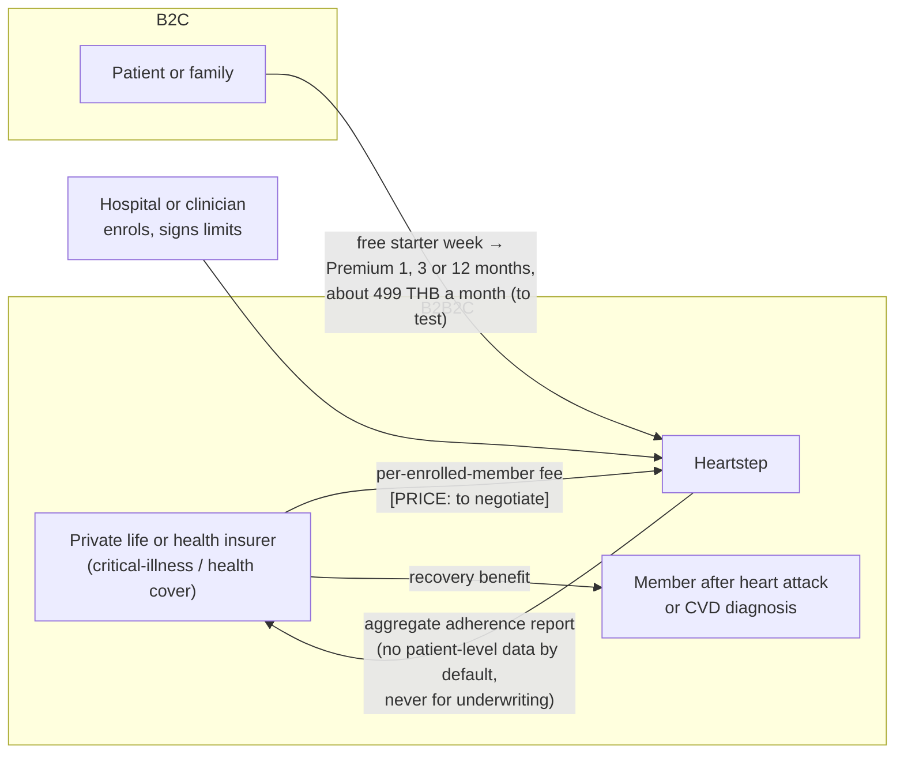

# P19 · Insurers can pay for recovery and patients can start free; both are hypotheses with a cheap test

## Key message

Heartstep has two payer routes: an insurer offers it as a recovery benefit after a heart-attack or critical-illness claim (B2B2C), and patients start free and move to Premium at about 499 THB a month (B2C). Abroad, the closest analogues are paid for by insurers and health plans, not by patients (Cardihab lists ten Australian private health funds and service providers; Movn lists US plans including Medicare), and published reviews find telerehabilitation usually costs the same or less than centre-based rehab. In Thailand we have spoken to no insurer and have no willingness-to-pay data, so the next step is a concierge pilot with 8–10 clinician-enrolled patients, not a market-size slide.

## Why this matters to the judges

- **Real-world impact.** Impact needs someone who pays. This page names the payer, the price hypothesis, the analogues that already get paid abroad, and the gaps.
- **Innovation.** Competitors abroad are clinician-led virtual rehab programmes. Heartstep's difference is the "Netflix" layer: it recommends activities and real community groups a patient will enjoy, in Thai, inside limits a clinician signed. That is a different product from a 12-week clinic programme delivered over video.
- **Credibility.** Judges have heard many TAM slides. We show no TAM because the Thai inputs are unverified, and we say how we will get them.

## Full detail

### The business model

| Route | Who pays | What they buy | Allowed pitch wording | Status |
|---|---|---|---|---|
| **B2B2C insurer** | Private life or health insurer, as a recovery benefit next to critical-illness or health cover | Enrolment of members after a cardiac claim; aggregate adherence reporting | "Designed to improve rehab adherence, which is linked to fewer readmissions" | Unverified in Thailand; no insurer contacted |
| **B2C freemium** | Patient or family | Free starter week, then Premium for 1, 3 or 12 months | "A plan kept inside your clinician's limits" | 499 THB is a hypothesis; no Thai WTP data |
| **Hospital channel** | Not a payer yet | Enrolment and limit signing at discharge | — | Needed for safety: every exercising user needs a signed limit |

**We do not say "proven to reduce readmissions".** We have no outcome data. Any outcome an insurer cares about (completion, 90-day readmissions against a matched comparison) is pre-registered for the insurer pilot gate (P21).

### Why insurers are the first payer in Thailand

Per our first-pass research (to verify): Thailand's public schemes (UCS, CSMBS, SSS) fund most acute cardiac care but have no fee code for standalone digital therapeutics or remote monitoring (cited to an APACMed position paper in the market report). So private payers and self-pay come first. Thai insurers already sell products built around a heart-attack claim: critical-illness plans covering acute heart attack are on the market from several insurers (FWD, Krungthai-AXA and Allianz Ayudhya appear in a search on 2026-10-18; we did not open those pages, so no product details are claimed here). A recovery benefit after such a claim is the natural insertion point. Whether any insurer would pay for it, and how much, is unknown.

### What the analogues show

| Name | Where | What it is | Who pays (from its own page) | Claims on its own page | How we read it |
|---|---|---|---|---|---|
| **Cardihab** | Australia and New Zealand | Digital cardiac rehab: clinician portal, participant app, telehealth | Lists Medibank, NIB, Bupa, Latrobe Health Services, Queensland Country Health Fund, HCF, Tasmanian Health Service, GMHBA, St Lukes, Westfund | 80% uptake vs 63% traditional; 94% adherence vs 68%; 80% completion vs 47%; RCT Varnfield et al., *Heart* 2014 | Vendor-reported. Strongest analogue for the insurer route: private health funds buy it |
| **Movn Health** | US | At-home cardiac rehab with a care manager; smart watch, BP cuff, scale, resistance bands | Medicare, Medicaid, EmblemHealth, UnitedHealthcare, MVP Health Care, BCBS Illinois and others; "Usually $0 cost" to the patient | "30% lower risk of second heart attack"; "Patients walk 40% farther by week 12"; "$10,000 in preventable medical costs saved"; "10,000+ patients since 2015" | Vendor-reported, US. Shows payers fund home rehab with a device kit |
| **EAPC EXPERT tool** | Europe | Decision support for clinicians writing exercise prescriptions | — | — | Prior art on the clinician side; Heartstep is patient-facing |
| ChatGPT Health / Claude for Healthcare | US | General assistants that can connect to health records | — | — | Not bounded by a signed limit or rules-first safety (P01) |
| AIA Vitality and other insurer wellness programmes | Thailand | Wearable-linked wellness rewards | — | — | A possible channel, not a competitor; our source is an awards page, so unsourced |

**Note on vendor figures.** The market report quoted Cardihab's uptake as "21% to 63%"; Cardihab's own page today says 80% vs 63%. Movn's report figures (20–30% fewer readmissions, US$1,377 per patient) are not what Movn's page states today. Vendor numbers move and are not independent trials; none appear on our slides as evidence for Heartstep.

**Our one-line differentiation:** a Thai-language recommender that matches each patient to activities and community groups they will enjoy, inside clinician-signed limits enforced by rules, with every plan stored as FHIR in IRIS for Health. The analogues are programmes; Heartstep is the daily layer that keeps a programme's limits alive after discharge.

### Does home or digital rehab save money? What independent reviews say

- **Scherrenberg, Falter and Dendale, *European Heart Journal – Digital Health*, 2020**, systematic review of 8 randomised trials (751 patients): "seven of the eight included studies demonstrated that telerehabilitation could lead to similar or lower long-term costs and are thus as cost-effective as traditional centre-based CR." Examples: Hwang et al. (Australia, 2019) intervention cost $2,325 vs $3,916 for the comparator; Maddison et al. (New Zealand, 2019) NZ$4,920 vs NZ$9,535; one Danish study (Kidholm 2016) at €518,280 per QALY was not cost-effective. The authors' caution: "Based on these small short duration trials".
- **Torrejón-Bote et al., ISPOR Europe 2026 poster**, systematic review of 14 economic evaluations: telerehabilitation "is a viable alternative to standard care, offering comparable effectiveness and generally lower costs", with results ranging from dominant to above €500,000 per QALY.

These reviews are about telerehabilitation programmes, not about Heartstep. They support the insurer conversation ("home-based rehab is usually not more expensive than centre-based"); they are not evidence that our app saves money.

### Price: where 499 THB sits

The market report suggests Thai self-pay tiers of **299–599 THB a month** (basic) and **1,500–3,500 THB a month** (clinical, with a wearable kit and nurse oversight). 499 sits inside the basic band. Two caveats from the simulated panel: the basic band was defined for computer-vision exercise coaching, and the clinical band cites non-Thai sources. The same report says 64.8% of one surveyed Thai cardiac population earned ≤ 10,000 THB a month, which argues for the insurer route over pure self-pay: 499 THB would be about 5% of such a monthly income.

### Unit economics we can and cannot state

| Item | Value | Status |
|---|---|---|
| Premium price | 499 THB ≈ US$14.26 at 35 THB/US$ | hypothesis; rate assumed |
| AI inference per patient-month | US$0.78 (Sonnet 5.5 API) to US$2.11 (one H100, 1,000 patients) | estimate (P16) |
| AI share of price | 5.5% to 15% | estimate |
| Clinician time per patient | — | not priced |
| IRIS licence and hosting | — | not priced |
| Customer acquisition cost | — | unknown |
| Insurer fee per member | [PRICE] | to negotiate |

We do not state a margin, because the largest cost lines are unknown.

### Why Thailand, why now (to verify against primary sources)

| Signal | Value | Caveat |
|---|---|---|
| Thai post-ACS recommendation | rehab no later than 10 days after discharge | guideline statement |
| Phase-2 rehab uptake after CABG | 12.5% | single-site study |
| Of those, never told about rehab | 83.3% | same study |
| Non-attendees citing lack of awareness | 61.9% | same study |
| Citing travel problems | 31.0% | same study |
| Citing inability to take leave from work | 19.0% | same study |
| Citing health complications | 14.3% | same study |
| Social support as a readmission predictor in Thai cohorts | β = −0.225 | correlational, not a peer-group trial |
| ACC statement, 15 Oct 2026 | rehab first-line; individualised prescriptions when rehab unavailable; digital tools may help adherence with structured programmes | news report of JACC statement (P18) |

The barrier pattern matters for the product: the biggest reported barrier is that nobody told the patient, and the next is travel. A recommender that starts at discharge, works at home and points to a group 1–3 km away addresses both. The social-support finding is why the community-group signal is in the recommender, with the panel's caution that a free-text peer community is not v1-safe; v1 recommends existing, real-world groups and offers a caregiver summary instead.

### Weak spots, flagged

| Weak spot | What we do about it |
|---|---|
| No insurer spoken to | 3–5 interviews with insurer product or claims leads and an actuary |
| No Thai willingness-to-pay data | 3–5 patient interviews, then a price test inside a clinician-onboarded cohort |
| Free week may be too short for habit formation | Test a longer free period only for non-exertional or clinician-limited content |
| "88% readmitted within 12 months" in the market report | Struck: it almost certainly describes readmitted patients only |
| Muang Thai Life ">70% CI premium growth" | Cited to an unrelated post; unsourced, not used |
| Smartwatch market sizes | From blogs and paid-report landing pages; not used |
| No TAM/SAM/SOM | Not shown until Thai post-MI incidence and private-cover data are verified |
| Payer-mix figure "0.3–2.5% private/self-pay" | From public-hospital registries, which exclude private hospitals; cannot size the market |

### The cheapest validation step

A **concierge pilot**: human-sent recommendations over LINE to 8–10 clinician-enrolled, low-risk patients, after ethics review. It tests whether patients follow recommended activities and groups, whether a caregiver summary helps, and what they would pay, before the full stack is built. In parallel, 3–5 insurer interviews test whether a recovery benefit has a budget owner.

## Visualizations

### Chart 1 · Range chart: where 499 THB sits

- **Type:** horizontal range (floating bar) chart with a point marker.
- **Title:** "Our 499 THB hypothesis sits in the report's basic self-pay band"
- **X axis:** THB per month, 0 to 4,000. **Y axis:** tier.
- **Data:**

| Tier | Low (THB) | High (THB) | Source | Status |
|---|---|---|---|---|
| Basic self-pay (report) | 299 | 599 | `research/market/notebooklm-deep-report.md` | model suggestion; defined for CV coaching |
| Clinical with wearable kit and nurse (report) | 1,500 | 3,500 | same | non-Thai sources |
| Heartstep Premium (hypothesis) | 499 | 499 | spec §2b | hypothesis |

- **What the reader should notice:** the price is a placeholder inside a suggested band, not a validated number.

### Chart 2 · Grouped bar chart: telerehab vs centre-based cost in two trials (independent review)

- **Type:** grouped vertical bars, one group per trial, separate currency labels.
- **Title:** "In a 2020 review, 7 of 8 trials found telerehab cost the same or less"
- **Data (Scherrenberg et al. 2020):**

| Trial | Currency | Telerehab cost | Comparator cost |
|---|---|---|---|
| Hwang et al. 2019, Australia | $ (as reported) | 2,325 | 3,916 |
| Maddison et al. 2019, New Zealand | NZ$ | 4,920 | 9,535 |

- **Annotation:** "Small, short trials; one Danish study (€518,280 per QALY) was not cost-effective. About telerehab programmes, not Heartstep."
- **What the reader should notice:** the insurer argument for home-based rehab has independent support; ours still needs its own pilot.

### Chart 3 · Bar chart: why Thai patients miss phase-2 rehab (single study, to verify)

- **Type:** horizontal bar chart.
- **Title:** "The top barrier is that nobody told them"
- **X axis:** % of non-attendees (multiple answers). **Y axis:** barrier.
- **Data:**

| Barrier | % |
|---|---|
| Lack of awareness | 61.9 |
| Travel or logistics | 31.0 |
| Cannot take leave from work | 19.0 |
| Health complications | 14.3 |

- **Annotations:** side note "83.3% of post-CABG patients said they were never told about phase-2 rehab; uptake 12.5%". Footer: "Single-site Thai study via machine-generated report; primary source (PMC11456183) to verify."
- **What the reader should notice:** the gaps are information and distance, which a recommender that starts at discharge and points to nearby groups can address.

### Chart 4 · Grouped bar chart: Cardihab's own reported outcomes (vendor-reported)

- **Type:** grouped bars, digital vs traditional.
- **Title:** "Vendor-reported: Cardihab digital rehab vs traditional"
- **Data:**

| Metric | Cardihab (%) | Traditional (%) |
|---|---|---|
| Uptake | 80 | 63 |
| Adherence | 94 | 68 |
| Completion | 80 | 47 |

- **Annotation:** "From cardihab.com, opened 2026-10-18. Not independent; not Heartstep."
- **What the reader should notice:** this is why insurers abroad buy digital rehab; it is not evidence for our product.

### Diagram · Who pays whom

The mermaid diagram in Full detail: insurer → Heartstep (fee, [PRICE]); Heartstep → insurer (aggregate report only); patient → Heartstep (free week, then Premium); hospital → Heartstep (enrols, signs limits). A crossed-out dotted arrow "patient-level data for underwriting".

## Numbers and claims ledger

| Claim | Value | Source | Status |
|---|---|---|---|
| Premium price | 499 THB a month; free starter week; 1, 3 or 12 months | `docs/superpowers/specs/2026-10-17-cvd-mission-coach-design.md` §2b | hypothesis |
| Insurer fee | [PRICE] | `pitch/deck-3min/slides/business.html` | missing |
| Suggested tiers | 299–599; 1,500–3,500 THB a month | `research/market/notebooklm-deep-report.md` | machine-generated |
| Income ≤ 10,000 THB a month | 64.8% of one surveyed population | same | to verify |
| No fee code for digital therapeutics in public schemes | — | same (APACMed paper) | to verify |
| Cardihab payers | ten named funds and services | https://www.cardihab.com/ (opened 2026-10-18) | checked (vendor page) |
| Cardihab outcomes | 80/63 uptake; 94/68 adherence; 80/47 completion | same | vendor-reported |
| Movn offer and payers | kit, care manager, plans listed, "Usually $0 cost" | https://www.movnhealth.com/ (opened 2026-10-18) | checked (vendor page) |
| Movn claims | 30% lower risk of second heart attack; 40% farther walk; $10,000 saved; 10,000+ patients | same | vendor-reported |
| Telerehab cost review | 7 of 8 RCTs similar or lower cost; 751 patients | https://pmc.ncbi.nlm.nih.gov/articles/PMC10087016 (Scherrenberg 2020) | checked |
| Trial costs | $2,325 vs $3,916; NZ$4,920 vs NZ$9,535; €518,280/QALY | same | checked |
| ISPOR 2026 review | 14 studies; "generally lower costs" | https://www.ispor.org/heor-resources/presentations-database/presentation-cti/ispor-europe-2026/poster-session-5-4/cost-effectiveness-of-home-based-cardiac-rehabilitation-a-systematic-review | checked (poster abstract) |
| Thai barriers | 61.9 / 31.0 / 19.0 / 14.3%; uptake 12.5%; never told 83.3% | `research/market/notebooklm-deep-report.md` §2 | to verify |
| Social support β | −0.225 | same; `research/pitch-claims-check.md` | to verify; correlational |
| AI share of price | 5.5–15% | P16 | estimate |
| Thai CI products covering heart attack | FWD, Krungthai-AXA, Allianz Ayudhya named in search results | web search 2026-10-18 (pages not opened) | to verify |

## Limits and open questions

- No insurer, actuary or claims lead has been interviewed; budget owner and sales cycle are unknown.
- No Thai willingness-to-pay data; 499 THB is a placeholder.
- No market size: Thai post-MI incidence, private-cover penetration among cardiac patients and smartwatch ownership among 45–75-year-old Thai cardiac patients are unverified.
- Vendor claims abroad are not independent; the independent cost reviews concern telerehab programmes with staff, not an app.
- Whether an insurer may see even aggregate adherence data, and on what consent, is a legal question (P20).
- Community-group partners (clubs, courts, temples, parks) are in the recommender, but no partnership or revenue from them is planned or claimed.

## Likely judge questions

1. **"Who pays?"** First a private insurer, as a recovery benefit after a cardiac claim; second the patient, after a free week. Abroad that is how the closest analogues are paid (Cardihab lists ten Australian funds and services). In Thailand it is untested, and the first step is 3–5 insurer interviews.
2. **"Why would an insurer pay?"** Because independent reviews find home-based rehab usually costs the same or less than centre-based rehab, and post-claim recovery is already a product theme. We will not claim fewer readmissions until a pre-registered pilot shows it.
3. **"How are you different from Movn or Cardihab?"** They are clinician-led programmes, often with a shipped device kit. Heartstep is a Thai-language recommender that keeps the clinician's limits alive every day by suggesting activities and nearby groups a patient enjoys, built on FHIR in IRIS for Health.
4. **"What is your market size?"** We do not show one. The Thai inputs we found are machine-generated or from blogs; we would rather show a cheap test than a weak number.
5. **"Will patients pay 499 baht?"** We do not know. The concierge pilot tests it with 8–10 clinician-enrolled patients, and the income data we found suggests the insurer route matters more than self-pay.

## Sources

Repo files:
- `docs/superpowers/specs/2026-10-17-cvd-mission-coach-design.md` §2b (business model, EXPERT tool)
- `research/README.md`; `research/market/notebooklm-deep-report.md` (corrections block); `research/market/sources.md`; `research/pitch-claims-check.md`
- `evaluation/reviews/2026-10-17-document/SYNTHESIS.md` R12, R13, R16, R17 and "five cheapest actions" (simulated panel); `m3-venture-market.md`
- `pitch/deck-3min/slides/business.html`; `pitch/main-3min.md`
- `pitch/appendix/A11-market-and-business.md`; `pitch/appendix-deck/P17-market-and-business.md`

External (opened 2026-10-18):
- Cardihab: https://www.cardihab.com/
- Movn Health: https://www.movnhealth.com/
- Scherrenberg, Falter, Dendale 2020: https://pmc.ncbi.nlm.nih.gov/articles/PMC10087016
- ISPOR Europe 2026 poster: https://www.ispor.org/heor-resources/presentations-database/presentation-cti/ispor-europe-2026/poster-session-5-4/cost-effectiveness-of-home-based-cardiac-rehabilitation-a-systematic-review
- ACC statement report: https://www.news-medical.net/news/20261015/New-scientific-statement-urges-doctors-to-prescribe-exercise-for-heart-health.aspx

## Image-generation prompt

Design one 16:9 information slide on a white background. Title, the key message: "Insurers can pay for recovery and patients can start free; both are hypotheses with a cheap test." Left: a simple payer diagram with three boxes, "Insurer (B2B2C) – recovery benefit, fee to negotiate, aggregate reports only", "Patient (B2C) – free week, then about 499 THB a month (to test)", "Hospital – enrols and signs limits". Centre: the bar chart "Why Thai patients miss phase-2 rehab (single study, to verify)": Lack of awareness 61.9%, Travel 31.0%, Cannot take leave 19.0%, Health complications 14.3%. Right: a small grouped bar "Telerehab vs centre-based cost (Scherrenberg 2020 review)": Australia 2,325 vs 3,916; New Zealand NZ$4,920 vs NZ$9,535, with the note "7 of 8 trials: same or lower cost". Bottom strip: "Gaps: no insurer interviewed · no Thai willingness-to-pay data · no market size shown · next: concierge pilot, 8–10 patients over LINE". No logos, no readmission claims, no other numbers. ChatGPT chooses the design.
