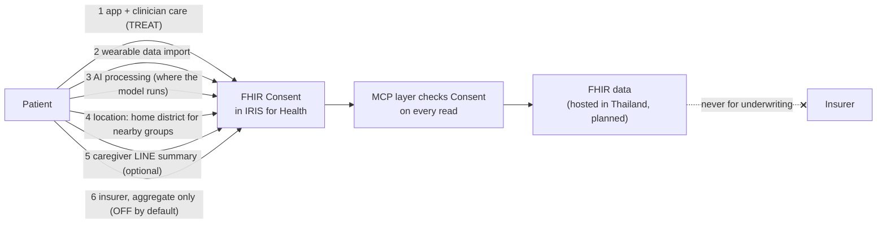

# P20 · Positioned as recovery support inside clinician limits; device class, PDPA and insurer data go to lawyers before any patient

## Key message

Heartstep v1 recommends activities and groups inside limits a clinician signed; it does not diagnose, set limits, change medication or replace cardiac rehab, and we word every claim that way. Whether Thai FDA would still treat it as Software as a Medical Device is open; the Thai framework has four risk classes with review periods of about 200 to 300 days per a secondary source, so the answer changes the timeline, and we will ask a regulatory lawyer in writing before any real patient. Health data is sensitive personal data under PDPA Section 26, so consents are explicit, separate and stored as FHIR `Consent`, with insurer access off by default and never for underwriting. **Nothing on this page is legal advice; every legal item needs a real lawyer.**

## Why this matters to the judges

- **Real-world impact.** A health AI that cannot pass regulatory and privacy review never reaches a hospital. Judges with clinical or industry backgrounds will ask "is this a medical device?" and "will my insurer see I skipped a walk?".
- **Use of InterSystems technology.** Consent, provenance and audit are FHIR resources in IRIS for Health (`Consent`, `Provenance`, `AuditEvent`), checked on every read by the MCP layer. Compliance is a data-model feature, not a PDF.
- **Technical coherence.** The regulatory position and the architecture match: the features most likely to be read as medical functions (setting intensity, triage) are exactly the ones the AI is not allowed to do.

## Full detail

### How we position v1

| We say | We avoid | Why |
|---|---|---|
| "Recommends activities and groups you'll enjoy, inside your clinician's signed limits" | "AI exercise prescription", "optimal, exact plan" | "Prescription" by an AI likely moves the product toward SaMD |
| "Designed to improve rehab adherence, which is linked to fewer readmissions" | "Proven to reduce readmissions" | No outcome data |
| "Stop now and call 1669" (fixed text, number to confirm) | Any symptom interpretation | Red flags are rules-only |
| "Supports and extends cardiac rehab; referral required" | "Replaces cardiac rehab" | Replacing rehab is a stated non-goal; the ACC Oct 2026 statement calls rehab first-line |
| "Ask your doctor or pharmacist" | Any drug or dose advice | Spec rule 9 |

**Draft intended-use statement (for the lawyer, not final):** Heartstep helps adults with a cardiovascular condition who have been enrolled by a clinician to follow that clinician's exercise limits. It recommends activities and community groups inside a clinician-signed limit record, schedules them with the patient, and stops and directs the patient to emergency care when warning symptoms are reported. It does not diagnose, set or change limits, change medication, or replace cardiac rehabilitation.

### The Thai FDA question: what we found, and what stays open

What we could confirm from sources we opened on 2026-10-18:

- Thailand regulates medical devices under the **Medical Device Act B.E. 2551 (2008)**, amended by the **Medical Device Act (No. 2) B.E. 2562 (2019)** (secondary source: meddeviceguide.com, reviewed 2026-04-04).
- Devices fall into **four risk classes**. The same secondary source gives the pathways and maximum review periods: Class 1 "Listing" (auto-approval or 200 days), Classes 2–3 "Notification" (250 days), Class 4 "License" (300 days), with import fees of about US$93, US$1,470 and US$2,220. It also says foreign manufacturers must work through a local Thai importer or licence holder.
- Thailand already treats some software as a medical device. A Tilleke & Gibbins note (17 June 2026) reports that the **Notification of the Ministry of Public Health on labeling and instructions for use for medical devices 2025** (Government Gazette 22 December 2025, effective **20 June 2026**) requires a UDI code for SaMD in risk categories 2, 3 and 4, with up to two years' transition for labels compliant with the 2020 notification.

What we could **not** find, and is open: the Thai criteria for when wellness or adherence software becomes a medical device, and which class Heartstep would fall into. **Needs a real lawyer.** We would send a written intended-use statement and feature list to a regulatory lawyer or a Thai FDA consultation channel before building the pilot.

### Feature by feature: where the medical-function risk sits

| Feature | Could be read as | Risk (our judgement, not legal) | Design choice |
|---|---|---|---|
| Choosing exercise intensity | Treatment planning | High if the AI set it | The AI never sets intensity; a clinician signs the limit, rules filter the catalogue, the model ranks only what is left |
| Recommending activities and groups | Lifestyle advice | Lower | Ranked by taste, similar users and distance, inside the allowed set |
| Red-flag stop message | Triage | Medium | Fixed text, rules only, always "stop and call"; no grading of symptoms |
| Discharge-note extraction (MedGemma 1.5 4B) | Clinical data processing | Medium | Extraction is a draft; a clinician confirms every field |
| Weekly progression proposal | Treatment change | Medium | Goes to the clinician queue as a proposal; never applied automatically |
| Eligibility gate | Risk stratification | Medium | Class entered by a clinician; the app only blocks on unknown or high |

The strategy is to keep every safety-relevant decision with a named clinician and deterministic rules, which is also what the safety design needs (P12). It may still not be enough for a "wellness" reading; that is the lawyer's call.

### PDPA: what the law says, as far as we checked

From a summary of the Thai Personal Data Protection Act B.E. 2562 we opened (Securiti, updated 20 February 2025) and search results describing Section 26:

- **Health data is sensitive personal data** (Section 26 lists health information, disability, genetic and biometric data among others). Processing it generally requires the data subject's **explicit consent**, unless another legal ground in Section 26 applies. Which ground fits a hospital-enrolled coaching app is for a lawyer.
- **Cross-border transfer** needs a destination with adequate protection or an approved mechanism; the summary names Binding Corporate Rules and Model Contractual Clauses (in force 24 March 2024).
- A **Data Protection Officer** is required when the core activity involves processing sensitive personal data, among other triggers. Heartstep's core activity does.
- **Penalties:** the summary states "The maximum penalty that can be awarded is a fine of Baht five million and imprisonment for a term not exceeding one year or both, depending on the type of the violation."

**Needs a real lawyer (privacy lawyer or hospital DPO):** lawful basis; who is controller and who is processor (hospital, Heartstep, cloud host, model host); whether any API model call is a cross-border transfer; retention and deletion; the Thai consent text.

### PDPA design: separate consents, stored as FHIR

Consent 4 is new in this version because the recommender is location-aware: it finds groups near the patient. We store **home district, not exact address** (`Patient.address.district` plus a district-level position extension), and the demo's group search uses a radius around that district point.

What exists today in the synthetic data: each patient has one `Consent` with scope `patient-privacy`, category LOINC 59284-0, policy OPTIN, a permit for purpose TREAT, and a nested **deny** for any actor with role `PAYOR` ("Any insurer"). The `PAYOR` code is to verify. The six separate consents above are the design, not yet the data.

Other data-minimising choices:

- No raw chat or watch streams in the vector index; only approved guideline content and the activity catalogue are embedded.
- The "people like you" signal uses aggregate, de-identified cohort statistics (in the demo, a synthetic cohort of 52); no other patient's identity or messages are shown.
- Insurers see aggregate adherence only, by default never patient-level data, and never for underwriting.
- Self-hosted models keep patient data and model calls in Thailand; API models only for de-identified work, if at all (P16).

### Insurers and the OIC

The Office of Insurance Commission (OIC) launched an **insurance regulatory sandbox notification on 9 May 2017**, which lets "insurers, agents, fintech/insurtech players to beta test insurtech innovations" with "more flexible regulatory requirement as deemed appropriate by the OIC" (Baker McKenzie guide, undated). A recovery benefit bundled with cover may or may not need sandbox or product-filing steps. **Needs an insurance lawyer or OIC-literate adviser:** whether an insurer may see individual adherence data at all; what consent covers aggregate reports; whether a recovery benefit changes a product filing; whether the sandbox applies.

### Accountability: who answers for what

| Question | Answer in the design | Recorded in FHIR as |
|---|---|---|
| Who set this limit? | A named clinician, with source test, date and review-by | `CarePlan` extensions, `Provenance` (attester) |
| Who chose this activity? | The model, from the allowed set, validated by rules; the patient confirmed | `Task` + `Provenance` (assembler = AI-model `Device`) |
| What did the agent see and call? | Every turn and tool call logged | `AuditEvent` (planned) |
| Who was told about a red flag? | The clinician | `Flag` + `Communication` |
| Who owns the limit library? | A named Siriraj clinician: **not yet named** | governance (spec rule 11) |

**Needs naming before any patient:** the accountable clinician, the incident-reporting route, and liability allocation between hospital, Heartstep and any insurer (hospital clinical safety committee and a lawyer).

### Ethics

Any real-patient use, including the concierge pilot over LINE, goes through a hospital IRB first. A statistician sets the pilot size and states what safety bound it can support (P21): with zero serious events in 20 patients, the 95% upper bound on the event rate is still about 14%.

### What the simulated panel said

The 2026-10-17 simulated panel (seven role-played reviewers; not real experts) scored "regulatory and privacy" at 1.14 of 4, the joint-lowest Track A dimension, because consent, PDPA and privacy appeared nowhere in the spec at that time. The consent design, intended-use draft and wording rules on this page were written in response. They have not been re-scored.

## Visualizations

### Chart 1 · Bar chart: Thai medical-device pathways by risk class (secondary source)

- **Type:** horizontal bar chart, with fee as a label.
- **Title:** "If Heartstep is a medical device, its class sets the clock (max review days, secondary source)"
- **X axis:** maximum review period, days. **Y axis:** class and pathway.
- **Data:**

| Class | Risk | Pathway | Max review (days) | Import fee (approx. US$) |
|---|---|---|---|---|
| 1 | Low | Listing | 200 (or auto-approval) | 93 |
| 2 | Low to moderate | Notification | 250 | 1,470 |
| 3 | Moderate to high | Notification | 250 | 1,470 |
| 4 | High | License | 300 | 2,220 |

- **Annotations:** footer "Source: meddeviceguide.com (reviewed 2026-04-04), not Thai FDA. Needs a real lawyer." A side note: "UDI labels required for SaMD in classes 2–4 from 20 June 2026 (MOPH notification 2025)."
- **What the reader should notice:** classification is a schedule question as much as a legal one, which is why it is asked first, at gate G-D.

### Chart 2 · Bar chart: simulated panel scores by dimension (Track A, 0–4)

- **Type:** horizontal bar chart.
- **Title:** "Before this design, regulatory and privacy was our weakest area (simulated panel, 2026-10-17)"
- **Data:**

| Dimension | Panel mean (0–4) |
|---|---|
| Clinical validity | 2.00 |
| Feasibility | 2.00 |
| Evidence and sourcing | 1.86 |
| Patient safety | 1.43 |
| Behaviour and adherence | 1.29 |
| Regulatory and privacy | 1.14 |
| Agent safety and evaluation | 1.14 |

- **Annotations:** label "Simulated reviewers (language-model role-play), not real experts; scored before consent design was added; not re-scored."
- **What the reader should notice:** we treat the gap as known and owned, not hidden.

### Chart 3 · Consent default chart

- **Type:** six-row toggle chart (a categorical "on/off/optional" strip chart).
- **Title:** "Six separate consents; insurer access is the one off by default"
- **Data:**

| Consent | Default | Needed for | In synthetic data today |
|---|---|---|---|
| App + clinician care (TREAT) | On (required) | any use | Yes (permit TREAT) |
| Wearable data import | On (asked) | heart-rate checks | No (design) |
| AI processing, with where the model runs | On (asked) | recommendations, chat | No (design) |
| Home district for nearby groups | On (asked) | community recommendations | district stored; consent not separate |
| Caregiver LINE summary | Optional | family support | No (design) |
| Insurer, aggregate only | Off | insurer reporting | Yes (deny role `PAYOR`) |

- **What the reader should notice:** the design separates every purpose, and the synthetic data already enforces the insurer deny.

### Diagram · Intended use vs not intended use

Two columns. Left "Does": recommends activities and groups inside a signed limit; schedules with the patient; stops and directs to 1669 on warning symptoms; reports to the clinician. Right "Does not": diagnose; set or raise limits; advise on medicine; replace cardiac rehab; share patient-level data with insurers.

## Numbers and claims ledger

| Claim | Value | Source | Status |
|---|---|---|---|
| Medical Device Act and amendment | B.E. 2551 (2008); No. 2 B.E. 2562 (2019) | https://meddeviceguide.com/blog/thailand-medical-device-registration-guide | secondary source; needs a real lawyer |
| Four classes, pathways, review days, fees | as in Chart 1 | same | secondary source; needs a real lawyer |
| SaMD UDI labelling | MOPH notification 2025; Gazette 22 Dec 2025; effective 20 Jun 2026; classes 2–4; 2-year transition | https://www.tilleke.com/insights/thailand-introduces-udi-labeling-requirements-for-software-as-a-medical-device/41/ | checked (law-firm note) |
| Heartstep device class | — | — | open; needs a real lawyer |
| Health data is sensitive (PDPA s.26); explicit consent unless another ground | — | https://securiti.ai/thailand-personal-data-protection-act-pdpa; search results on s.26 | secondary; needs a real lawyer |
| Cross-border mechanisms | BCRs and model clauses, in force 24 Mar 2024 | securiti.ai | secondary; needs a real lawyer |
| DPO trigger | core activity processing sensitive data | securiti.ai | secondary; needs a real lawyer |
| Maximum PDPA penalty | fine of Baht five million and/or up to one year imprisonment | securiti.ai | secondary; needs a real lawyer |
| OIC sandbox | notification launched 9 May 2017 | https://resourcehub.bakermckenzie.com/en/resources/asia-pacific-insurance/asia-pacific/thailand/topics/guide-to-insurtech-innovation-and-utilization | secondary; needs a real lawyer |
| Synthetic Consent content | scope patient-privacy, LOINC 59284-0, OPTIN, permit TREAT, deny PAYOR | `synthetic/generate_fhir.py`, `synthetic/README.md` | synthetic; PAYOR code to verify |
| Home district, not address | — | `docs/pitch/faq-appendix/slides/geo.html`; `synthetic/` | checked |
| Synthetic cohort size in demo | 52 | `demo/agent-flow-demo.html` | synthetic |
| Panel score, regulatory and privacy | 1.14 of 4 | `evaluation/reviews/2026-10-17-document/SYNTHESIS.md` | simulated |
| Zero events in 20: 95% upper bound | ≈ 13.9% (exact), 15% (rule of three) | arithmetic; `system-eval.md` L3 | checked |
| Patient-facing emergency number | 1669 | spec rule 3 | to confirm with clinician |

## Limits and open questions

- No lawyer, DPO, Thai FDA officer, OIC adviser or IRB has reviewed anything. All legal statements are from secondary summaries.
- Thai criteria separating wellness software from SaMD were not found.
- Controller and processor roles across hospital, Heartstep, cloud and model hosts are undefined.
- Whether a caregiver LINE summary is a disclosure needing its own consent wording in Thai is open.
- Whether insurers may receive even aggregate adherence data, and whether a recovery benefit affects product filing, is open.
- The accountable clinician is not named; without one, there is no patient use.

## Likely judge questions

1. **"Is this a medical device?"** We do not know yet, and we will not guess. We designed it so that the AI never sets limits or triages, wrote a draft intended-use statement, and will put it to a regulatory lawyer before any patient, because a Class 2–4 answer means a review period of up to about 250–300 days.
2. **"Will my insurer see that I skipped a walk?"** No, by design. Insurer access is a separate consent, off by default, aggregate only, never patient-level and never for underwriting; the synthetic `Consent` already denies the `PAYOR` role.
3. **"Where does the data live?"** In IRIS for Health on a server in Thailand (planned), with self-hosted models for patient-identifying calls, so no cross-border transfer is needed for core use. Any API use would be de-identified, subject to legal review.
4. **"Who is liable if a patient is hurt?"** The clinician who signs the limit is accountable for the limit; the app is accountable for staying inside it, which rules and tests enforce. Liability allocation between hospital, us and any insurer needs a lawyer and the hospital's safety committee, and we have not done it yet.
5. **"Do you need IRB approval for a pilot?"** Yes, for any real-patient use including the concierge pilot over LINE. That is gate G-D on the roadmap (P21).

## Sources

Repo files:
- `docs/superpowers/specs/2026-10-17-cvd-mission-coach-design.md` §2b, §4, §5 (rules 3, 5, 9, 11)
- `evaluation/reviews/2026-10-17-document/SYNTHESIS.md` R3, R8, R10, scores; `evaluation/reviews/2026-10-17-document/s4-regulatory-ethics.md` (simulated)
- `synthetic/generate_fhir.py`, `synthetic/README.md` (Consent with PAYOR deny, district-only address)
- `docs/pitch/faq-appendix/slides/geo.html`, `docs/pitch/faq-appendix/slides/cost.html`
- `demo/agent-flow-demo.html` (cohort, group search)
- `pitch/appendix/A12-regulatory-pdpa.md`, `pitch/appendix-deck/P18-regulatory-pdpa.md`

External (opened 2026-10-18):
- Tilleke & Gibbins, UDI for SaMD: https://www.tilleke.com/insights/thailand-introduces-udi-labeling-requirements-for-software-as-a-medical-device/41/
- Thailand medical device registration guide: https://meddeviceguide.com/blog/thailand-medical-device-registration-guide
- Securiti PDPA summary: https://securiti.ai/thailand-personal-data-protection-act-pdpa
- Baker McKenzie, insurtech guide (OIC sandbox): https://resourcehub.bakermckenzie.com/en/resources/asia-pacific-insurance/asia-pacific/thailand/topics/guide-to-insurtech-innovation-and-utilization

## Image-generation prompt

Design one 16:9 information slide on a white background. Title, the key message: "Recovery support inside clinician limits; device class, PDPA and insurer data go to lawyers before any patient." Main visual: a horizontal bar chart "If it is a medical device, the class sets the clock (max review days, secondary source)": Class 1 Listing 200, Class 2 Notification 250, Class 3 Notification 250, Class 4 License 300. Beside it a six-row consent toggle panel: "App + clinician care ON", "Wearable data ON", "AI processing ON", "Home district for nearby groups ON", "Caregiver LINE summary optional", "Insurer, aggregate only OFF" (the OFF in orange). Small text: "Health data is sensitive under PDPA s.26: explicit, separate consents stored as FHIR Consent". A clear badge: "NOT LEGAL ADVICE · needs a real lawyer". No logos, no other numbers. ChatGPT chooses the design.
