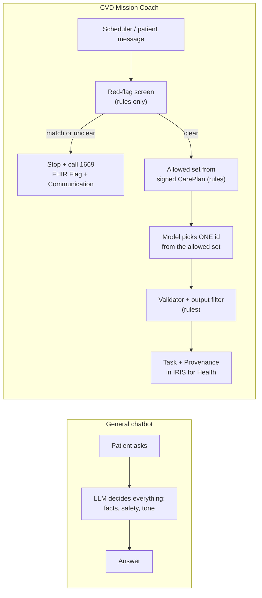

# A01 · Why not just ask ChatGPT or Claude?

**One-line answer:** A general chatbot gives everyone the same advice from memory. Heartstep is a chat coach that works like Netflix for a healthy heart: it recommends activities and community groups you will enjoy (your taste, people like you, near you), only from what your doctor’s signed care plan allows, with red flags handled by rules.

## The honest framing

General models are strong reasoners. OpenAI and Anthropic now both connect health records and Apple Health for **US users** (sources below). We are not claiming a smarter model. Our claim is that **the model is bounded**:

1. Limits come from a signed record (`CarePlan` + `Provenance` in IRIS for Health), not from whatever the patient types.
2. Safety is decided by fixed code **before** any model sees the message.
3. The app pushes 1–2 small missions at a time the patient chose. It does not wait for a question.
4. It works in Thai, from Thai speech in to Thai text checked against the facts.
5. The care team sees flags, a weekly summary and an audit trail.

## Side by side

| Question | General chatbot | CVD Mission Coach |
|---|---|---|
| Knows the clinician's limits? | Only if the patient types them in | Signed FHIR limit record. Rules block anything outside it |
| Who starts? | The patient opens the app and asks | Pushes 1–2 missions at the time the patient chose |
| Chest pain mid-walk? | The model decides what to say | Rules stop first: recorded audio, call 1669 *(number to confirm with clinician)* |
| Watch data in Thailand? | Health in ChatGPT launched for US users only | HealthKit / Health Connect into FHIR, hosted in Thailand *(planned)* |
| Older Thai patients? | Text chat, general voice | Thai speech in. Thai text is checked against the facts |
| Does the care team see it? | No | Flag queue, weekly summary, audit trail |
| Can it invent a place or a group? | Yes | No. Places and groups come only from FHIR `Location` / `HealthcareService` |
| Can it raise a limit? | It can say anything | No tool can write limits. A "do more" request goes to the clinician |

## What we measured (synthetic, but it shows the failure mode)

In our tool-router experiment (see [A06](A06-tool-router-experiments.md)), a plain small model doing native tool calling showed both failures that a bounded design must block:

- **It invented a fact.** Asked "วันนี้ฝุ่น PM2.5 เยอะไหม" ("is PM2.5 high today?"), Qwen3-0.6B **answered "currently high" without calling the air-quality tool**.
- **It has no concept of red flags.** In every v1 run (Qwen3-0.6B, 1.7B and 4B), the plain "LLM writes the tool call" setup missed **4 of 4** red-flag messages. With the rules gate in front, **0 of 4** were missed in the same runs.

Synthetic messages, n = 36 per run. This shows the mechanism, not real-world accuracy.

## Why this matters to an InterSystems judge

A general chatbot keeps patient context in a prompt. We keep it in **standard FHIR R4 resources** in IRIS for Health. Each model decision becomes a `Task` with a `Provenance` that names the model and the allowed set. A clinician, an auditor or a hospital system can read that record without trusting the model.

## Prior art we know about

- **EAPC EXPERT tool:** digital decision support that helps **clinicians** write exercise prescriptions for CVD patients. Our difference: it is patient-facing, adapts daily from the watch, and runs as a conversation (design spec §2b).
- **Movn Health (US)** and **Cardihab (Australia):** clinician-led virtual cardiac rehab. See [A11](A11-market-and-business.md).

## Limits of this answer

- The chatbot comparison rests on two news sources about US launches. Re-check them before quoting on stage *(to verify)*.
- Our "hosted in Thailand" and Thai speech pipeline are **planned**. Only the Heartstep UI prototype, synthetic FHIR data and the router experiments exist today.

## It is also cheaper, for the patient and for us

- **Patient:** ChatGPT Plus is ฿699 a month in Thailand and Claude Pro is US$20 (≈ ฿674). Heartstep Premium is planned at about ฿499 (a price to test) and includes the signed care plan, local groups and the stop path that general assistants do not have. Free tiers exist, so we say "cheaper than the paid assistants", not "cheaper than free".
- **Us:** because rules decide 60% of messages and the rest need one 71 ms forward pass with no generated tokens ([A06](A06-tool-router-experiments.md)), routing 1,000 patient messages costs about ฿0.19 on a rented T4, against about ฿8 on GPT-5 mini and about ฿56 on Claude Sonnet 5.5 for the same messages ([A08](A08-cost-structure.md)). Safety does not add cost: the red-flag path is rules-only and is the cheapest path in the system ([A07](A07-safety-and-evaluation.md)).
- Measured on synthetic messages; prices from list prices on 2026-10-18 at ≈ 33.7 THB/US$; see A08 limits.

## Sources / evidence in repo

- `docs/pitch/faq-appendix/slides/chatbot.html`: comparison table and sources (OpenAI, "Launching Health in ChatGPT", US, July 2026; Clinical Trials Arena on Claude for Healthcare, JPM 2026)
- `experiments/RESULTS_tool_router_demo.md`: PM2.5 invented-answer failure, red-flag misses of config A
- `experiments/tool_router_demo_results_Qwen3-*_cuda.json`, `experiments/tool_router_demo_results_Qwen3-0.6B_mps.json`: raw numbers
- `docs/superpowers/specs/2026-10-17-cvd-mission-coach-design.md` §2b (EXPERT tool), §5 (safety rules)
- `docs/diagrams/backend-architecture.dc.html`: rules-only stop path
