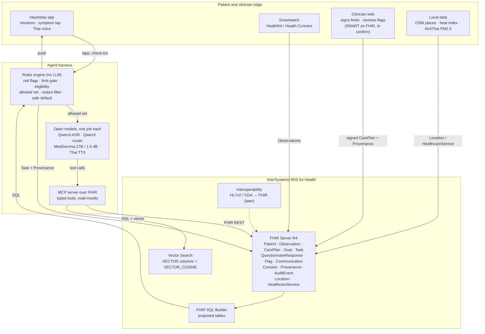
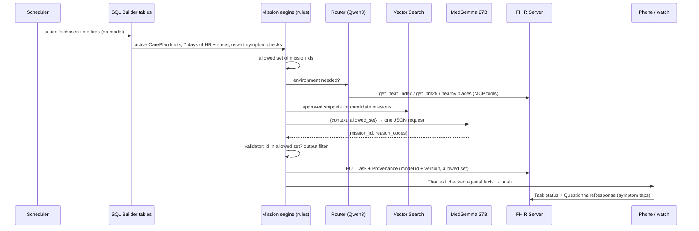

# A02 · How is the system built?

**One-line answer:** InterSystems IRIS for Health is the single source of truth. The FHIR R4 server holds every fact. FHIR SQL Builder feeds the rules engine. IRIS Vector Search grounds the models. The agents can read and write only through typed MCP tools over FHIR, and no tool can write a clinician limit.

## Layered view

## The rule that holds the design together

**The rules engine owns safety. The agent owns conversation.** The agent can only choose missions the rules engine has marked as allowed. It reads limits and never writes them. The backend diagram calls this the "tooling layer": the only things the agent can touch.

| Layer | What it does | LLM inside? |
|---|---|---|
| 1. Inputs | App chat and taps, watch data, clinician limit record, discharge note, consent | No |
| 2. Ingestion and safety gates | Symptom screen and red flag, data bridge (drop implausible HR, dedupe, fix timezone), limit-record gate, eligibility gate | **No (rules only)** |
| 3. Agent harness | Coach agent plus MCP tool surface. The mission engine (rules) builds the allowed set | Agent yes, mission engine no |
| 4. Output control and audit | Output filter (blocks drug or dose advice, diagnosis wording, intensity above the limit), notification scheduler, clinician flag queue, audit log | **No (rules only)** |
| 5. Apps | Today screen, push mirrored to the watch, clinician web, weekly summary | No |

**Safe default:** with no watch data, no network, an LLM outage or an implausible reading, the app shows the last approved mission or a rest or light mission. Intensity never goes up.

## Where each InterSystems capability carries weight

| IRIS capability | Our use | Status |
|---|---|---|
| FHIR Server (R4) | All patient facts as standard resources (see [A03](A03-fhir-data-model.md)) | Synthetic bundles built and validated. Loader script written for the kit's server |
| FHIR SQL Builder | Projects `CarePlan` limits, `Observation`s, `Task`s and `QuestionnaireResponse`s into SQL for the rules engine and weekly analytics | Planned |
| Vector Search | Grounding for MedGemma over clinician-approved content. Semantic ranking of activities and places (see [A05](A05-intersystems-vector-search-and-geo.md)) | Planned |
| FHIR search on `Location` / `HealthcareService` | Places and community groups near the home district | Synthetic resources built. `near` support on IRIS still to confirm |
| MCP over FHIR (kit pattern: FastMCP) | The only door between agents and data | Planned |
| Interoperability (HL7v2 / CDA → FHIR) | Hospital discharge summary arrives as FHIR | Later, not in the demo |

## One daily mission as a FHIR round trip

## Built vs planned (be exact on stage)

| Exists today | Planned |
|---|---|
| Heartstep UI prototype with rules-only checks (`safety.js`: `hasRedFlag`, `canExercise`). `npm test` 6/6 pass | IRIS for Health deployment with our data loaded |
| Synthetic FHIR R4 bundles: 9 transaction bundles, 383 resources, validated with `fhir.resources` R4B | FHIR SQL Builder projection and rules engine over SQL |
| `synthetic/load_to_iris.py` for the kit server (`localhost:52773/fhir/r4/`) | Vector tables and Thai embedding model |
| Tool-router experiments v1 and v2 (Colab T4, synthetic) | MCP server over FHIR, model serving, Thai TTS |
| Scripted in-browser agent-flow demo (`demo/agent-flow-demo.html`) | Clinician web app, SMART on FHIR scopes |

## Sources / evidence in repo

- `docs/diagrams/backend-architecture.dc.html`: five-layer backend, safe default, tooling layer
- `docs/pitch/faq-appendix/slides/architecture.html`: IRIS for Health as source of truth
- `docs/pitch/appendix-slides-plan.md`: A1 and A3 plans, daily-mission sequence
- `docs/superpowers/specs/2026-10-17-cvd-mission-coach-design.md` §5–6
- `docs/ui-vs-agentic-plan.md`: UI status and test result
- `FHIR-AI-Hackathon-Kit/README.md` and `skills/iris-ai-agents/SKILL.md`: FastMCP and LangChain pattern
- `synthetic/README.md`, `synthetic/generate_fhir.py`, `synthetic/load_to_iris.py`
