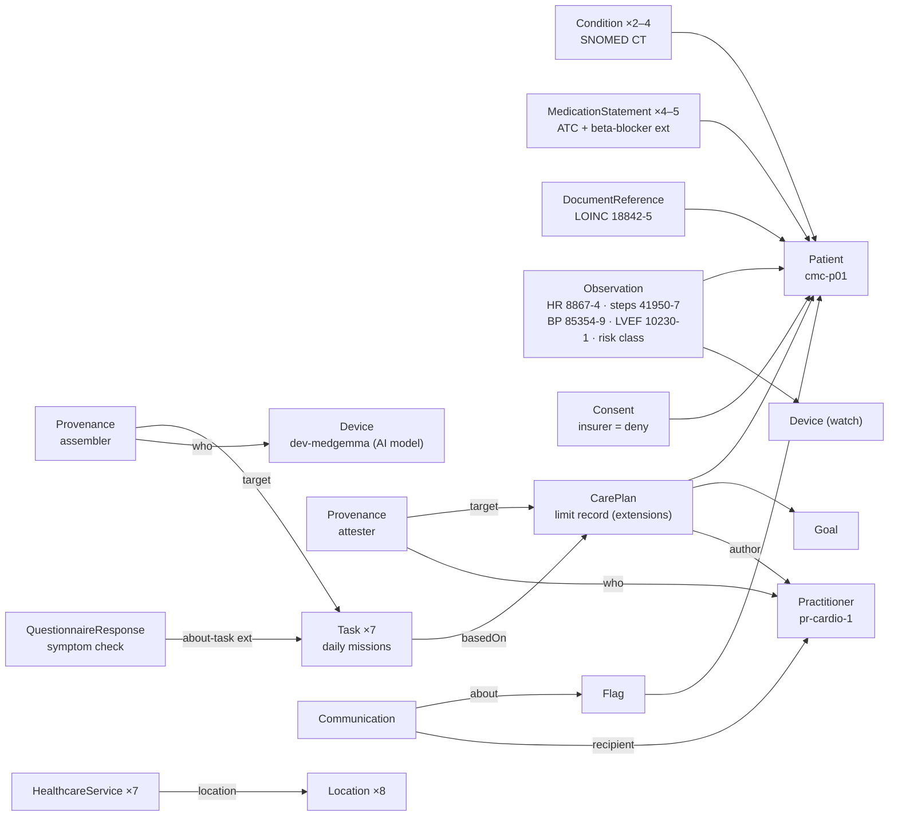

# A03 · Is the data model thoughtful and interoperable?

**One-line answer:** Every fact the agent uses is a standard FHIR R4 resource. That includes the watch readings, the clinician-signed limit record, each daily mission, each symptom tap, red-flag events, consent and the AI's own provenance. We already generate it as 9 idempotent PUT transaction bundles (383 synthetic resources, validated with `fhir.resources` R4B), ready to load into the IRIS for Health FHIR server from the InterSystems hackathon kit.

> **All data in this file is synthetic.** Every resource carries `meta.tag` `data-origin = synthetic`. No real patient, clinician, clinic or place is involved.

## Resource map



## Resource by resource, with the synthetic examples

| Our concept | FHIR R4 resource | Key fields and codes (as generated) | Synthetic example | Who writes it in production |
|---|---|---|---|---|
| Patient | `Patient` | `communication.language` = `th` (BCP-47), preferred. `address.district` only (no street). Extension `home-district-position` (lat/lon) | `cmc-p01` Somchai Kaewmanee, Bang Na (demo patient) | Onboarding |
| Diagnoses | `Condition` | SNOMED CT: 22298006 MI, 38341003 hypertension, 44054006 T2DM, 49436004 AF, 84114007 HF, 232717009 CABG history. Clinical and verification status | p01: MI + hypertension | Clinician, or MedGemma 1.5 4B extraction then clinician confirmation |
| Medicines | `MedicationStatement` | ATC, e.g. C07AB07 bisoprolol, B01AC06 aspirin, B01AC24 ticagrelor, C10AA05 atorvastatin. `dosage.text`. Extension `beta-blocker` = true | p01: bisoprolol 2.5 mg + 3 others | Clinician-confirmed |
| Discharge note | `DocumentReference` | LOINC 18842-5 "Discharge summary". `attachment.data` is base64 UTF-8 text (spec-correct; the kit's 3.1 notebook uses hex) | "SYNTHETIC DISCHARGE SUMMARY…" | Patient upload or hospital feed |
| Watch | `Device` | `deviceName` (Apple Watch, Galaxy Watch, Garmin Venu, Huawei Watch) | `cmc-p01-watch` | Health data bridge |
| Heart rate | `Observation` | Category `vital-signs`. LOINC 8867-4. UCUM `/min`. `device` → watch | 7 daily resting-HR readings | Health data bridge |
| Steps | `Observation` | Category `activity`. LOINC 41950-7 "Number of steps in 24 hour Measured". `effectivePeriod` = the day | 7 days | Health data bridge |
| Blood pressure | `Observation` | LOINC 85354-9 panel. Components 8480-6 systolic and 8462-4 diastolic, `mm[Hg]` | 2 panels per patient | Patient or cuff |
| LVEF | `Observation` | Category `imaging`. LOINC 10230-1. Unit `%` | p03: 42%, p04: 30% | Clinician |
| Risk class | `Observation` | Local code `aacvpr-risk-class`. Value low / moderate / high / unknown | p04: high | Clinician only |
| Consent | `Consent` | Scope `patient-privacy`. Category LOINC 59284-0. `policyRule` OPTIN. `provision` permit, purpose TREAT, with a nested **deny** for actor role `PAYOR` ("Any insurer") | Every patient | Patient |
| Limit record | `Goal` + `CarePlan` | `CarePlan.status` active (signed) or draft (awaiting clinician). `period.end` = review-by date. `author` = Practitioner. Extensions: `hr-ceiling` (Quantity), `rpe-target` (Range 11–13), `limit-source` (cpet / 6mwt / exercise-ecg), `allowed-activity` (repeating code), `restriction` (string) | p01: HR ≤ 110, RPE 11–13, CPET, walking + stationary cycling. p05: "No upper-body resistance until 12 weeks after CABG" | **Named clinician only** |
| Signature on limits | `Provenance` | `target` → CarePlan. Agent type `attester`, `who` → Practitioner | `cmc-p01-limits-prov` | Clinician web |
| Daily mission | `Task` | `intent` plan. `basedOn` → the limit CarePlan. `code` = mission id (`walk-10-easy`, `walk-12-easy`, `cycle-10-easy`, `rest-day`). `executionPeriod` = patient's time. `status` requested / completed / failed / cancelled | 7 per eligible patient | Mission engine, after validating the model's pick |
| AI accountability | `Provenance` | `target` → Task. Agent type `assembler`, `who` → `Device/dev-medgemma`. Reason `picked-from-allowed-set` | One per Task | Every model node |
| Symptom tap | `QuestionnaireResponse` | `questionnaire` = `…/Questionnaire/symptom-check|1.0`. Items: chest-pain, breathless, dizzy, palpitations (boolean), rpe (integer). Extension `about-task` → Task | One per finished mission | Patient (fixed choices, no free text) |
| Not eligible | `Flag` | Local code `app-ineligible`. `author` = clinician | p04 (LVEF 30%, ICD) | Eligibility rules, clinician confirms |
| Red flag | `Flag` + `Communication` | Flag category `clinical`, code `red-flag-chest-symptom`. Communication `recipient` → Practitioner, `about` → Flag. Later Tasks become `cancelled` | p07: chest tightness on day 5 | **Red-flag rules only** |
| Places | `Location` | `position` lat/lon. `hoursOfOperation`. Type (park, temple, indoor-mall, rehab-gym, track). Extension `indoor` | 8 fictional Bangkok-area places | Curated list (team, later partners) |
| Groups and classes | `HealthcareService` | `location` → Location. Category `exercise-activity`. Extension `activity-intensity` (light / moderate). `comment` is free text, used for vector search | "Air-conditioned mall walkers club", light | Curated list |

`AuditEvent` (every agent turn and tool call) is in the design but **not yet generated** in the synthetic set.

## The 8 synthetic patients (each one tests a path)

| Id | Case | What the app should do | Resources |
|---|---|---|---|
| cmc-p01 | Low risk after MI, CPET limit, beta-blocker | Normal daily missions | 52 |
| cmc-p02 | Aged 71, limit from 6-minute walk, low tech comfort | Simple missions, caregiver help | 50 |
| cmc-p03 | Moderate risk, LVEF 42% | Supervised sessions first | 51 |
| cmc-p04 | High risk, LVEF 30%, ICD | Blocked: `Flag` "not eligible", no CarePlan, no Tasks | 29 |
| cmc-p05 | 6 weeks after bypass surgery | Walking only, upper-body restriction | 52 |
| cmc-p06 | New sign-up, limit record in **draft** | No exercise missions | 28 |
| cmc-p07 | Chest tightness on day 5 | Red-flag `Flag` + `Communication`. Later Tasks `cancelled` | 52 |
| cmc-p08 | AF and other conditions, low adherence, fasting days | Evening missions (19:00), many missed | 49 |
| shared | Organization, 2 Practitioners, AI-model Device, Questionnaire, 8 Locations, 7 HealthcareServices | Reference data, loaded first | 20 |

Totals by type: Observation 143, Provenance 48, Task 42, MedicationStatement 36, QuestionnaireResponse 27, Condition 18, Device 9, Patient 8, DocumentReference 8, Consent 8, Location 8, Goal 7, CarePlan 7, HealthcareService 7, Practitioner 2, Flag 2, Organization 1, Questionnaire 1, Communication 1. **383 in total.**

## PUT transaction bundles (idempotent loading)

The kit's tutorial POSTs Synthea bundles, and **POSTing the same bundle twice creates duplicates** (kit `iris-fhir` skill). Our generator uses `PUT Type/id` with stable ids, so reloading **updates** resources instead of duplicating them:

```json
{
  "fullUrl": "https://cvd-mission-coach.example/fhir/CarePlan/cmc-p01-limits",
  "resource": {
    "resourceType": "CarePlan", "id": "cmc-p01-limits",
    "status": "active", "intent": "plan",
    "subject": {"reference": "Patient/cmc-p01"},
    "title": "Clinician-signed exercise limit record",
    "period": {"start": "2026-10-04T09:00:00+07:00", "end": "2026-11-29T09:00:00+07:00"},
    "author": {"reference": "Practitioner/pr-cardio-1"},
    "extension": [
      {"url": ".../StructureDefinition/hr-ceiling", "valueQuantity": {"value": 110, "unit": "beats/minute", "system": "http://unitsofmeasure.org", "code": "/min"}},
      {"url": ".../StructureDefinition/rpe-target", "valueRange": {"low": {"value": 11}, "high": {"value": 13}}},
      {"url": ".../StructureDefinition/limit-source", "valueCode": "cpet"},
      {"url": ".../StructureDefinition/allowed-activity", "valueCode": "walking"},
      {"url": ".../StructureDefinition/allowed-activity", "valueCode": "stationary-cycling"}
    ],
    "meta": {"tag": [{"code": "synthetic"}]}
  },
  "request": {"method": "PUT", "url": "CarePlan/cmc-p01-limits"}
}
```

Loading (`synthetic/load_to_iris.py`): POST each bundle to `http://localhost:52773/fhir/r4/` (kit default, Basic auth `SuperUser`/`SYS`, local demo only). The shared reference bundle loads first because patient bundles reference it. Any `OperationOutcome` issue is printed and the load stops. The generator runs `Bundle.model_validate` (R4B models, as in the kit) before writing. The kit notes that the server validates more strictly than `fhir.resources`.

## How FHIR SQL Builder projects it for the rules engine (planned)

The kit's tutorial 3.5 describes five steps in the FHIR management portal (`/csp/fhir-management`): **Credentials → Repository configuration (`/fhir/r4`) → Analysis → Transform specification → Projection** (into a SQL package). We would define one transform spec, for example package `CMC`:

| Projected table (proposed) | From | Columns the rules engine needs |
|---|---|---|
| `CMC.LimitRecord` | `CarePlan` | id, subject reference, status, period.end (review-by), author, hr-ceiling, rpe low/high, limit-source |
| `CMC.AllowedActivity` | `CarePlan.extension[allowed-activity]` | careplan id, activity code |
| `CMC.Vital` | `Observation` | subject, LOINC code, effective time, value, unit, device |
| `CMC.Mission` | `Task` | id, subject, basedOn, mission code, status, executionPeriod.start |
| `CMC.SymptomCheck` | `QuestionnaireResponse` | subject, about-task, authored, linkId, answer |
| `CMC.Place` | `Location` + `HealthcareService` | id, type, latitude, longitude, open/close, intensity, indoor |

Illustrative rule query (IRIS SQL uses `SELECT TOP`, not `LIMIT`; final names depend on the transform spec):

```sql
-- Gate 1: is there a signed, current limit record? (no row = no exercise missions)
SELECT TOP 1 l.ID, l.HrCeiling, l.RpeLow, l.RpeHigh
FROM CMC.LimitRecord l
WHERE l.Subject = 'Patient/cmc-p01' AND l.Status = 'active'
  AND l.PeriodEnd > CURRENT_TIMESTAMP;

-- Gate 2 (unresolved red flag = no exercise missions) reads a projected Flag table the same way.

-- Context: last 7 days of resting HR and steps, for the allowed set and the weekly summary
SELECT v.Code, AVG(v.Value) AS Mean7d
FROM CMC.Vital v
WHERE v.Subject = 'Patient/cmc-p01' AND v.Effective >= DATEADD('dd', -7, CURRENT_TIMESTAMP)
GROUP BY v.Code;
```

The same IRIS namespace can hold `VECTOR` columns, so one SQL statement can filter on projected FHIR columns and rank by `VECTOR_COSINE` (see [A05](A05-intersystems-vector-search-and-geo.md)).

## Open choices and things to verify

- `Task` vs `CarePlan.activity` for missions. We chose `Task` because each mission has its own status, time and Provenance.
- `Flag` vs `DetectedIssue` for red flags. We chose `Flag` + `Communication`.
- **To verify:** every LOINC, SNOMED CT and ATC code against the official browsers. The `PAYOR` role code in Consent. Whether the IRIS FHIR server accepts our custom extensions without profiles. Whether SQL Builder can project extension values and repeating extensions as columns.
- Our own concepts (risk class, mission ids, limit extensions, intensity) use the placeholder system `https://cvd-mission-coach.example/fhir/...`. A real deployment needs published profiles.
- **Fixed inconsistency:** cmc-p07 was first generated with LVEF 48% but risk class "low"; it is now LVEF 53%, consistent with the low-risk band (LVEF ≥ 50%).
- In the synthetic data, the mission `Provenance` points at the MedGemma Device, but **no model ran**. The generator writes the shape of the record. A production Provenance will also carry the model version and the allowed set it chose from.

## Sources / evidence in repo

- `synthetic/generate_fhir.py`: every code, extension URL and the PUT `entry()` builder
- `synthetic/fhir/00_shared_reference_data.json`, `synthetic/fhir/p01…p08_*.json`: the bundles (counts computed from these files)
- `synthetic/README.md`: patient cases, codes, "check before real use" list
- `synthetic/load_to_iris.py`: loader for the kit server
- `docs/pitch/appendix-slides-plan.md` §A2: resource map and open choices
- `FHIR-AI-Hackathon-Kit/skills/iris-fhir/SKILL.md`: POST duplicates, base64 vs hex, server validation
- `FHIR-AI-Hackathon-Kit/Tutorials/3-fhir/markdown/3.5-projecting-fhir-data-in-sql.md`: SQL Builder steps
- `FHIR-AI-Hackathon-Kit/skills/iris-sql-python/SKILL.md`: `SELECT TOP`, DB-API
