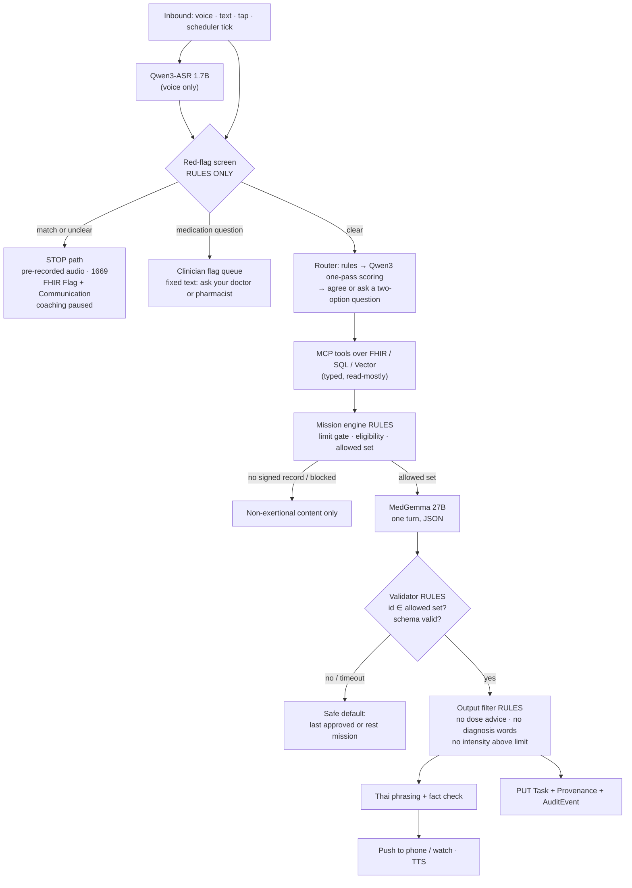
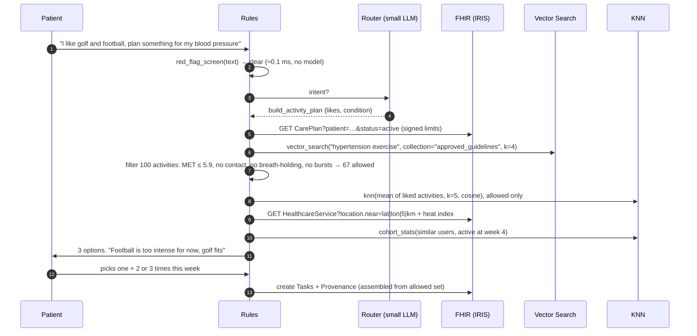

# A04 · What runs inside the agent harness?

**One-line answer:** Open models each do one narrow job with a typed input and output: they hear, route, choose and speak. Fixed rules decide what is safe before and after every model call. The model never sets a limit. It only picks an id from a set the rules engine allowed, and the result is written to IRIS for Health as a FHIR `Task` with a `Provenance`.

## Models, one job each

| Job | Model | Why this one | Known limits we design around |
|---|---|---|---|
| Hear (speech → text) | **Qwen3-ASR 1.7B** | Thai is a listed language. Apache-2.0. Streams on vLLM | Thai accuracy on older speakers and colloquial speech still to test |
| Route and call tools | **Qwen3-4B or Qwen3-1.7B** | Tool calling and MCP support. Qwen3 lists 119 languages including Thai | In our tests (A06) native tool calling was slow and missed every red flag, so we route by scoring, not by writing the call |
| Choose the mission | **MedGemma 27B (text)** | MedGemma 1 card reports MedQA 85.3. Used for one English JSON request: choose from the allowed set | Card: not for direct clinical decisions, not optimised for multi-turn, red-teamed mainly in English. So: single turn, English, closed choice, validated |
| Read discharge notes | **MedGemma 1.5 4B (multimodal)** | MedQA 69.1, 128K context | Extraction only. **A clinician confirms** every field before it counts |
| Thai phrasing | Qwen3-8B or Typhoon 2 *(to choose)* | Thai text generation | Output is fact-checked against the chosen mission and limits |
| Speak | **Qwen3-TTS** (English); Thai: **Typhoon2-Audio 8B or JaiTTS** *(to test)* | Qwen3-TTS open weights cover 10 languages and **not Thai** | Safety audio (stop message, 1669) is **pre-recorded**, never synthesised live |
| Red flags, limits, eligibility, allowed set, output filter, safe default | **No model. Rules only** | Must be deterministic and testable | Phrase list needs a Thai-speaking clinician |

## The graph



## Typed contracts (proposed)

Agents touch data only through these MCP tools. The kit already shows the pattern (FastMCP over IRIS SQL and FHIR REST). **No tool writes limits.**

| Tool | Kind | Input → output | Guard |
|---|---|---|---|
| `get_patient_limits()` | Read | → HR ceiling, RPE range, allowed activities, review-by (from the signed `CarePlan`) | Read-only. Missing or expired returns "no record" |
| `get_recent_activity(days)` | Read | → steps, HR summary, missions done (`Observation`, `Task`) | `days` capped |
| `get_hr_summary(days)` | Read | → resting and in-mission HR summary | Implausible readings already dropped by the data bridge |
| `get_heat_index(district)` / `get_pm25(district)` | Read | → current band | District only, never exact address |
| `search_places(type, radius, open_at)` | Read | → up to 3 `Location`s | Results come only from FHIR, never generated |
| `search_activities(intensity_max, near, text)` | Read | → up to 3 `HealthcareService`s | `intensity_max` set by the rules engine, not by the model |
| `propose_week_plan(mission_ids[])` | Write | → accepted or rejected | Server re-validates every id against the allowed set |
| `schedule_notification(mission_id, time)` | Write | → scheduled | Time window rules (no midday heat default) |
| `log_checkin(text)` | Write | → logged | Append-only. Text passes the red-flag screen first |

The tool-scope audit in our evaluation plan treats **any write tool beyond `propose_week_plan`, `schedule_notification` and `log_checkin` as a finding**.

MedGemma's contract is a closed choice:

```jsonc
// request (English, single turn)
{"patient_context": "post-MI, low risk, beta-blocker, 4/7 walks done last week, afternoon heat high",
 "allowed_set": ["walk-10-easy", "walk-12-easy", "rest-day"],
 "reason_codes": ["keep-level", "easier-after-missed-days", "heat", "progress-duration"]}
// response
{"mission_id": "walk-10-easy", "reason_codes": ["keep-level", "heat"]}
```

If `mission_id` is not in `allowed_set`, or the JSON is invalid, or the call times out, the validator discards it and the safe default runs. (The field names are a proposed contract, not yet implemented.)

## Workflows W1–W5

| Workflow | Trigger | Rules do | Models do | FHIR written | Prototype today |
|---|---|---|---|---|---|
| **W1 Onboarding** | Sign-up | Eligibility gate: unknown risk, ICD, low LVEF, unstable symptoms, recent surgery → refer. No signed record → no exercise | MedGemma 1.5 4B reads a discharge-note photo. **Clinician confirms** | Patient, Condition, MedicationStatement, DocumentReference, Consent, draft CarePlan | Form only. Exercise locked until `clinicianApproved`. No ICD, LVEF or beta-blocker questions yet |
| **W2 Daily loop** | Patient-chosen time | Allowed set from limits + 7-day data + heat/PM2.5. Symptom tap before and after | MedGemma picks the id. Thai phrasing | Task, Provenance, QuestionnaireResponse | Two mission cards. Walk fixed at 12:30, which conflicts with the heat rule (open fix) |
| **W3 Check-in / coach** | Patient message or voice | Red-flag screen first. Medication → clinician queue | Router + MCP tools (places, groups, limits). Qwen3-ASR for voice | AuditEvent; Task updates | Scripted replies. `hasRedFlag` runs first. "Raise my limit" is refused |
| **W4 Weekly review** | Weekly | Progression caps: duration before intensity, one variable at a time, weekly cap from the clinician | MedGemma drafts a one-sentence summary and a bounded proposal **for the clinician** | Communication to the clinician queue | Check-in modal. Limits unchanged |
| **W5 Red flag** | Any match, tap or "I feel unwell" | Stop, pre-recorded audio, 1669, pause coaching | **None** | Flag + Communication. Later Tasks cancelled | Stop banner, `tel:1669`, persists across reload. No clinician flag yet |

## The demo flow (scripted, synthetic)

`demo/agent-flow-demo.html` plays the full agent trace in the browser. The patient is "Somchai, 58, high blood pressure". He says he likes golf and football.



| Step | What happens | Technology |
|---|---|---|
| 1. Limits | Signed `CarePlan` read: up to about 5.9 METs, HR under 110, RPE 11–13, avoid straining and breath-holding | FHIR Server |
| 2. Guideline vector search | Four approved guideline lines retrieved to explain the plan | IRIS Vector Search |
| 3. Filter 100 activities | 100-item Thai/English catalogue (golf, petanque, takraw, ram mai phlong, ruesi dat ton…). Rules keep 67 (44 intensities from the 2024 Compendium). Tennis (or football) is excluded and the patient is told why | Rules (SQL in production) |
| 4. KNN | Nearest allowed activities to what the patient enjoys (e.g. walking golf, walking football) | Vector similarity |
| 5. Community | Groups near the home district at a cool time of day | FHIR `HealthcareService` near-search + heat tool |
| 6. Similar users | Share of similar users still active at week 4 | Cohort query |
| 7. Patient choice | The patient picks one of 3, and how often | The patient decides, not the AI |
| 8. Save | Tasks + Provenance inside the limits | FHIR Server |

**Honesty notes for the demo:** it is scripted JavaScript, not live models. The KNN runs on hand-made 11-dimension activity tag vectors, not learned embeddings. MET values are approximate, "in the style of the Compendium of Physical Activities", and must be checked by a clinician. Guideline lines are paraphrased examples, not quotations. Community groups and the "similar users" cohort (n = 52, with percentages) are **invented**. The demo patient id `cmc-p01` is not one of the 8 synthetic FHIR bundles.

## Sources / evidence in repo

- `docs/pitch/faq-appendix/slides/harness.html`: hear / decide / speak, MedGemma card limits
- Model facts: team agentic plan (Claude Doc linked in `HANDOFF.md`), checked against model cards Oct 2026 (`docs/pitch/faq-appendix/slides/sources.html`)
- `docs/ui-vs-agentic-plan.md`: W1–W5 mapping and UI gaps
- `docs/diagrams/backend-architecture.dc.html`: MCP tool surface, output filter, safe default
- `docs/superpowers/specs/2026-10-17-cvd-mission-coach-design.md` §5–6: rules 1–11, tool list
- `.claude/skills/siriraj-mit-review-panel/references/system-eval.md`: tool-scope audit rule
- `demo/agent-flow-demo.html`: demo steps, catalogue, limits, invented cohort
- `FHIR-AI-Hackathon-Kit/skills/iris-ai-agents/SKILL.md`: FastMCP tools over IRIS
