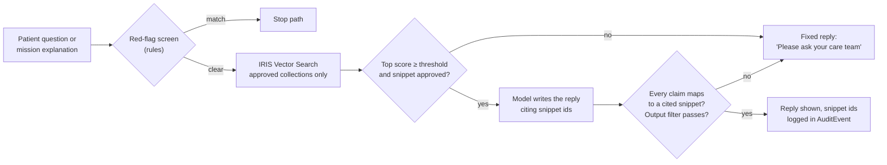
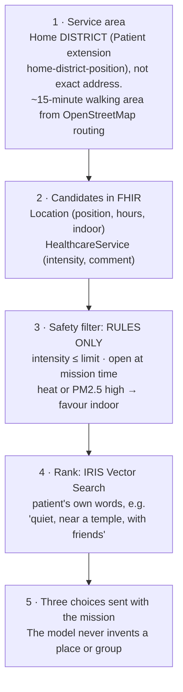

# A05 · How do you use IRIS Vector Search and local data?

**One-line answer:** IRIS Vector Search keeps the models grounded in clinician-approved content only: if there is no retrieved snippet, there is no answer. It also ranks real places and groups near the patient's home district. The candidates come from FHIR `Location` and `HealthcareService` resources, and fixed rules filter them before anything is ranked.

## What we embed

| Collection | Source | Used for | Status |
|---|---|---|---|
| Mission-library explanations | Written by the team, approved by a clinician | Grounding MedGemma's "why this mission" text | Planned |
| Patient education snippets | Clinician-approved, each with its source | Answers to plan questions in the coach chat | Planned |
| Guideline snippets | Reconciled table (`RECONCILE-for-clinician.md`), **only after clinician sign-off** | Clinician summary references | Blocked on clinician |
| Community activities | Curated, intensity-tagged list (`HealthcareService.comment`) | "Find a quiet morning walk near a temple" | 7 synthetic services exist |
| Discharge notes | `DocumentReference` text | Onboarding extraction support | Synthetic notes exist |

We do **not** embed raw patient chat or watch streams for retrieval.

## How it runs in IRIS

From the kit's `iris-vector-search` pattern:

```sql
CREATE TABLE CMC.ApprovedContent (
  Collection VARCHAR(40),     -- mission | education | guideline | activity
  SourceRef  VARCHAR(200),    -- e.g. HealthcareService/svc-mall-walk or guideline id + page
  ApprovedBy VARCHAR(100),    -- clinician who approved it
  Lang       VARCHAR(5),      -- th | en
  Text       VARCHAR(10000),
  Embedding  VECTOR(DOUBLE, <dim>)   -- dim must equal the embedding model's output
);

-- Hybrid query: SQL filters first (rules), then semantic rank
SELECT TOP 3 SourceRef, Text,
       VECTOR_COSINE(Embedding, TO_VECTOR(?, DOUBLE)) AS Score
FROM CMC.ApprovedContent
WHERE Collection = 'activity' AND ApprovedBy IS NOT NULL
ORDER BY Score DESC;
```

- `VECTOR_COSINE` means higher is closer. Query and stored vectors must come from the same model (kit skill).
- The same namespace holds the FHIR SQL Builder tables, so one statement can join projected FHIR columns (intensity, opening hours) with vector rank.

## Grounding rule



**Rule:** the patient sees an answer only if it cites retrieved snippets. Otherwise the reply is a fixed "ask your care team" message. The score threshold is to be tuned on a labelled set, not guessed.

## Thai needs a multilingual embedding model (to test)

The kit uses OpenAI `text-embedding-3-small` (1536 dimensions) through an API. For Thai patient content we need two things:

1. **Thai retrieval quality.** Candidate: **BGE-M3** (named in our plan). Its Thai quality is **not measured yet**.
2. **Data residency.** Patient-side text should be embedded on our own hosted model, not through a foreign API (see [A12](A12-regulatory-pdpa.md)).

Test plan (not run):

| Step | Detail |
|---|---|
| Query set | Thai, English and mixed queries in the style of our router set (colloquial, elderly phrasing, typos), each labelled with the correct snippet ids |
| Arms | BGE-M3 self-hosted vs the kit's `text-embedding-3-small` baseline (other multilingual candidates may be added) |
| Metrics | Recall@3, MRR, and the share of "no good answer" queries correctly sent to the fixed reply |
| Rule | Pick the threshold on a calibration split. Report on a held-out split written by someone else, the same blind protocol as router v2 ([A06](A06-tool-router-experiments.md)) |

## Geo: real places near home, filtered by rules, ranked by Vector Search



| Data | Source | In FHIR as |
|---|---|---|
| Parks, temples, malls, tracks | OpenStreetMap | `Location` with `position`, `hoursOfOperation`, `indoor` extension |
| Walking groups, tai chi, mall walkers, rehab classes | Curated list (no public API exists for Thai community exercise groups) | `HealthcareService` with `activity-intensity` extension, `location` reference |
| Heat | Thai Meteorological Department or Open-Meteo | Tool result (not stored per patient) |
| PM2.5 | Air4Thai | Tool result |

Synthetic examples: "Air-conditioned mall walkers club" (light, indoor loop, "good on hot or smoky days"). "Supervised cardiac rehab class" (moderate, ECG telemetry, needs referral). "Evening walking circle, Community Track" ("friendly for fasting days").

### FHIR near-search (to confirm on IRIS)

FHIR R4 defines `Location?near=lat|lon|distance|units`. The demo calls the chained form `HealthcareService?location.near=13.67|100.60|5|km`. **Whether the IRIS FHIR server supports `near` (and the chained form) is still to confirm** with the capability statement (`/fhir/r4/metadata`) or the InterSystems mentors. Fallback if it does not: project `Location.position` with FHIR SQL Builder and filter by distance in SQL. Rules still run before ranking either way.

## Why this is more than "IRIS as a vector store"

Calvin's note on judging (`HANDOFF.md`) says the weak version is a chatbot over PDFs with IRIS as a plain vector store. In our design:

- Vector Search sits **behind** FHIR-based rules. It ranks only what the limits already allow.
- The ranked items are **FHIR resources** (`HealthcareService/svc-mall-walk`), so what the patient picks becomes a `Task` that references them.
- Grounded answers cite approved snippet ids, and those ids are logged for audit.

## Sources / evidence in repo

- `docs/pitch/appendix-slides-plan.md` §A4: embedded collections, grounding rule, BGE-M3 candidate
- `docs/pitch/faq-appendix/slides/geo.html`: 5-step service-area flow, data sources, honest gap, near-search to confirm
- `FHIR-AI-Hackathon-Kit/skills/iris-vector-search/SKILL.md`: VECTOR DDL, `TO_VECTOR`, `VECTOR_COSINE`, hybrid filters, 1536-dim model
- `synthetic/generate_fhir.py`: Location and HealthcareService resources, intensity and indoor extensions
- `demo/agent-flow-demo.html`: `vector_search(...)` and `location.near` calls in the scripted trace
- `HANDOFF.md`: hybrid SQL + vector idea, "plain vector store" is the weak version
