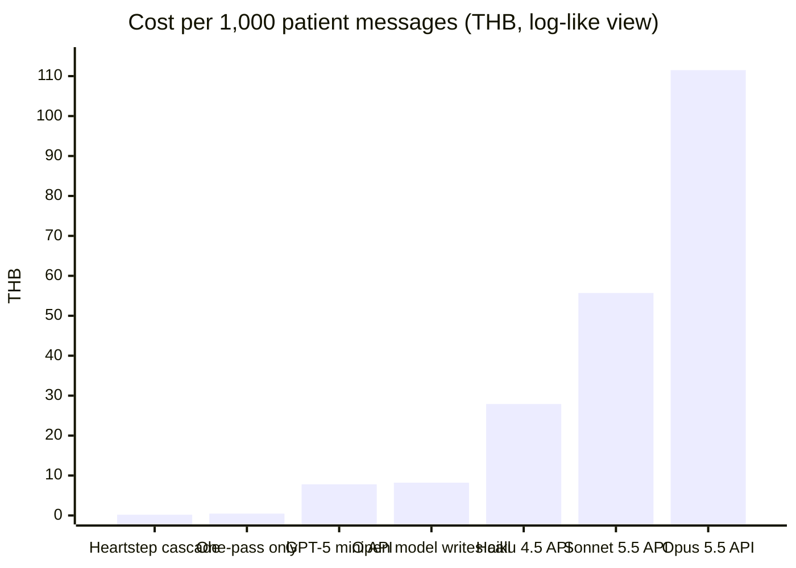
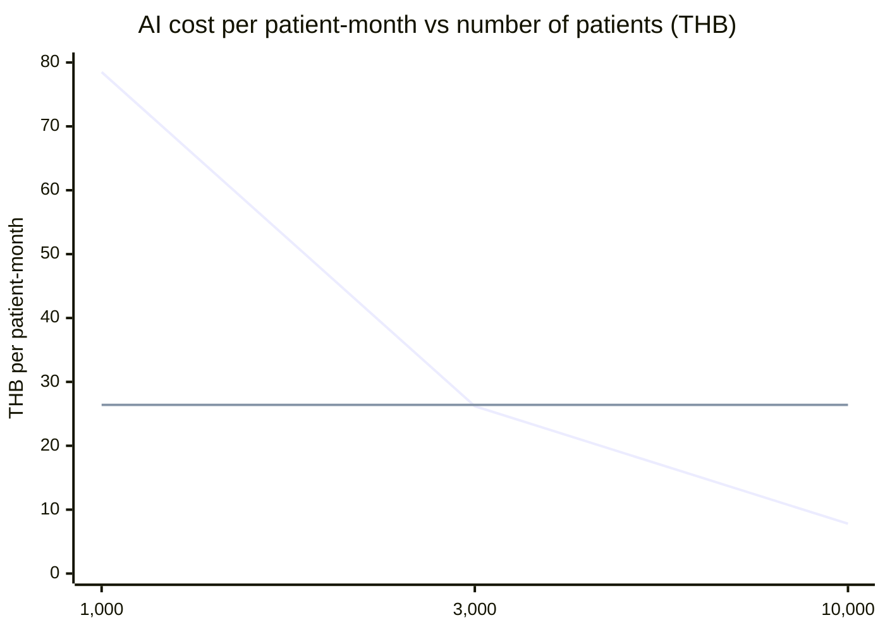

# A08 · What does it cost, and is it cheaper than ChatGPT or Claude?

> **Story, part 3 of 3.** [A06](A06-tool-router-experiments.md) measured a router that is accurate, deterministic and fast: rules decide 60% of messages, and the rest need one 71 ms forward pass that generates no tokens. [A07](A07-safety-and-evaluation.md) showed the safety path is the cheapest path. This page turns those measurements into baht.

**One-line answer:** For the patient, Heartstep Premium (about ฿499 a month, a price we will test) costs less than ChatGPT Plus (฿699) or Claude Pro (about ฿674), and includes what they do not: a doctor-signed limit, real groups nearby, and a rules-only stop path. For us, the measured router costs about **฿0.19 per 1,000 patient messages** on a rented T4 GPU, against about ฿8 on GPT-5 mini and about ฿56 on Claude Sonnet 5.5 for the same messages. The whole AI bill is a few percent of the price.

> All prices are list prices checked on 2026-10-18 and converted at **≈ 33.7 THB per US$** (October 2026). Router speeds are measured on **synthetic** messages. The per-patient token budget is an **estimate** we have not measured yet. Read the "Limits" section before quoting.

## 1. What the patient pays each month

| Option | Price per month | What it includes for a heart patient | Source |
|---|---|---|---|
| ChatGPT Plus | **฿699** (incl. VAT) | Strong general assistant; answers when asked; no doctor-signed limit, no local groups, model decides safety | glbgpt.com, "official 2026 price in baht" (to verify at OpenAI checkout) |
| Claude Pro | **US$20 ≈ ฿674** (before any VAT) | Same category; health-record connectors are US-focused | Claude Pro pricing, US$20/month |
| Free tiers of either | ฿0 | Message limits; same gaps as above | — |
| **Heartstep Premium** | **≈ ฿499** (hypothesis) | Recommendations inside a signed care plan, groups near home, daily missions, rules-only red-flag stop, clinician link | Our price to test |

**Reading:** ฿499 is about 29% less than ChatGPT Plus and about 26% less than Claude Pro. The bigger difference is not the price; it is what the patient gets for it (see [A01](A01-why-not-chatgpt.md)). Free tiers exist, so the honest pitch is "cheaper than the paid assistants, and the only one built around your doctor's limits", not "cheaper than free".

## 2. What one routing decision costs us (measured speed, list prices)

A "routing decision" is turning one patient message into the right tool or answer path. These figures use measured latencies from [A06](A06-tool-router-experiments.md) (Qwen3-1.7B on a Tesla T4) and measured prompt and output sizes: a 617-token cached prefix plus about 40 message tokens (657 input tokens), and 34 generated tokens when a model writes the tool call.

| How the decision is made | GPU time or tokens per 1,000 messages | Cost per 1,000 messages | In baht |
|---|---|---|---|
| **Heartstep cascade** (rules decide 59.6%; one-pass for the rest) | 404 × 71 ms = **29 GPU-s** | US$0.0055 | **฿0.19** |
| One-pass scoring on every message (no rules) | 1,000 × 71 ms = 71 GPU-s | US$0.0136 | ฿0.46 |
| Same open model writes the tool call | 1,000 × 1,272 ms = 1,272 GPU-s | US$0.244 | ฿8.2 |
| GPT-5 mini API (US$0.25 in / US$2 out per M) | 657k in + 34k out tokens | US$0.232 | ฿7.8 |
| Claude Haiku 4.5 API (US$1 / US$5) | same tokens | US$0.83 | ฿27.9 |
| Claude Sonnet 5.5 API (US$2 / US$10) | same tokens | US$1.65 | ฿55.7 |
| Claude Opus 5.5 API (US$4 / US$20) | same tokens | US$3.31 | ฿111.5 |

T4 price: **US$0.69 per GPU-hour**, the median on-demand price across 9 providers (getdeploying.com, 2026-10-18).

**Why the cascade is so cheap:** it skips the model for 6 messages in 10 (rules), and for the other 4 it reads one set of scores instead of generating 34 tokens. The same idea helps on any backend: even if we called an API, routing first would cut the number of paid calls by about 60%.

## 3. What one patient costs us per month (estimate)

The router is only one part of the AI. The daily mission choice (MedGemma), Thai phrasing and voice add more. Our planning budget is about **7,800 input + 1,050 output tokens per patient per day** (one daily mission, two short check-ins, a weekly summary), so about **234,000 input and 31,500 output tokens a month**. This is an estimate; it is not measured yet.

| Where the models run | AI cost per patient-month | In baht | Share of ฿499 |
|---|---|---|---|
| GPT-5 mini API | US$0.12 | ฿4.1 | 0.8% |
| Claude Sonnet 5.5 API | US$0.78 | ฿26.4 | 5.3% |
| Claude Opus 5.5 API | US$1.57 | ฿52.8 | 10.6% |
| Self-hosted open models, 1 rented H100 (US$3.19/h, about US$2,329 a month), 1,000 patients | US$2.33 | ฿78.5 | 15.7% |
| Same H100, 3,000 patients | US$0.78 | ฿26.2 | 5.2% |
| Same H100, 10,000 patients (if one GPU holds the load; to measure) | US$0.23 | ฿7.8 | 1.6% |

(First line: self-hosted H100. Second line: Claude Sonnet 5.5 API, flat.) They cross at about **3,000 patients** (US$2,329 ÷ US$0.78).

**Why self-host at all, if a small API model is cheap?** Not for price at pilot scale; GPT-5 mini would cost about ฿4 per patient. We self-host because patient data stays in Thailand under PDPA, Thai speech models are open-weight, the whole pipeline is deterministic and auditable, and cost stops growing per token as we scale. At pilot size we can run on an API or a small rented GPU; the cascade keeps either option cheap.

## 4. The full unit-cost picture (what is and is not in the numbers)

| Cost line | Status |
|---|---|
| AI inference (router, mission choice, phrasing) | Estimated above |
| Thai speech in and out | Not priced; Qwen3-ASR runs on the same GPU; Thai TTS engine not chosen |
| InterSystems IRIS for Health licence | Not priced (Community edition for the hackathon) |
| Clinician time to sign and review limits | **Not priced; likely the largest line** |
| Customer acquisition, support, redundancy GPU | Not priced |

So the defensible claim is narrow: **AI is a small line in the unit cost, and the safety design makes it smaller, not bigger.** The large unknowns are people (clinicians) and the IRIS licence.

## Limits (read before quoting)

- Router latencies are single-stream on a T4 with synthetic messages; batching would lower GPU cost further, and real messages may be longer.
- The GPU figures assume the GPU is busy; an idle rented GPU still costs money, an API does not.
- API costs per message exclude conversation history; a real chatbot resends history each turn and costs more.
- The 7,800 + 1,050 tokens per patient-day budget is unmeasured.
- ChatGPT Plus ฿699 comes from a secondary page; GPT-5 mini prices come from a secondary page (OpenAI's pricing page returned HTTP 403 to our fetch). Verify both before stage.
- The exchange rate moves; at 35 THB/US$ every baht figure above rises about 4%.

## Sources

Repo: `experiments/RESULTS_tool_router_demo.md` and `experiments/*_cuda.json` (latencies, tokens, tier counts, prefix length) · `docs/pitch/faq-appendix/slides/cost.html` (token budget) · `pitch/appendix-v2-deck/P16-cost-structure.md` (H100 US$3.19/h check).

External (2026-10-18; the getdeploying.com T4 page was opened, the others were found by web search and must be opened before quoting):
- ChatGPT Plus in Thailand, ฿699/month: https://www.glbgpt.com/hub/chatgpt-plus-cost-in-thailand/ (secondary; to verify)
- Claude Pro US$20/month: https://www.eesel.ai/blog/claude-pro-pricing
- Claude API list prices (Opus 5.5 US$4/US$20, Sonnet 5.5 US$2/US$10, Haiku 4.5 US$1/US$5): Anthropic API pricing
- GPT-5 mini US$0.25 / US$2.00 per M tokens: https://morphllm.com/openai-api-pricing (secondary; to verify)
- NVIDIA T4 median US$0.69/GPU-hour, H100 listings: https://getdeploying.com/gpus/nvidia-t4
- USD/THB ≈ 33.7 (October 2026): https://www.poundsterlinglive.com/history/USD-THB-2026
