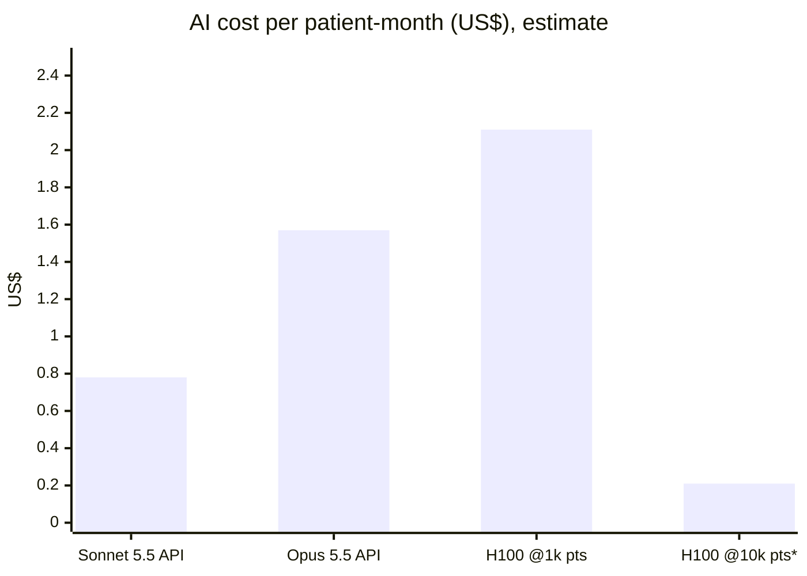

# A08 · What does the AI cost per patient?

**One-line answer:** On our estimated token budget (not yet measured), AI inference costs about US$0.78 per patient per month on Claude Sonnet 5.5, or about US$2.11 per patient per month on one self-hosted H100 at 1,000 patients. Either is small next to a 499 THB (about US$14) monthly price. The biggest costs are people: clinician sign-off time and the IRIS licence, both still to price.

## The numbers

| Option | Basis | Per patient per month |
|---|---|---|
| Same load on Claude Sonnet 5.5 API | US$2 in / US$10 out per M tokens | **≈ US$0.78** |
| Same load on Claude Opus 5.5 API | US$4 in / US$20 out per M tokens | **≈ US$1.57** |
| Our open models, 1 rented H100, 1,000 patients | ≈ US$2.89 per GPU-hour, 24/7 | **≈ US$2.11** |
| Same GPU, 10,000 patients | Only if one GPU holds the load (**to measure**) | **≈ US$0.21** |
| Premium price | 499 THB at an assumed 35 THB per US$ | ≈ US$14 |
| Break-even | Patients at which one rented GPU costs the same as the Sonnet 5.5 API | ≈ 2,700 |

## How the numbers are built

**Token budget (assumption, unmeasured):** about **7,800 input + 1,050 output tokens per active patient per day**. That covers one daily mission call, two short voice check-ins and a share of a weekly clinician summary.

| Step | Calculation | Result |
|---|---|---|
| Monthly tokens | 7,800 × 30 = 234,000 in. 1,050 × 30 = 31,500 out | 0.234 M in, 0.0315 M out |
| Sonnet 5.5 | 0.234 × $2 + 0.0315 × $10 = 0.468 + 0.315 | **$0.78** |
| Opus 5.5 | 0.234 × $4 + 0.0315 × $20 = 0.936 + 0.630 | **$1.57** |
| H100 per month | $2.89 × ~730 h | **≈ $2,110** |
| Per patient at 1,000 | $2,110 / 1,000 | **$2.11** |
| Per patient at 10,000 | $2,110 / 10,000 (if capacity holds) | **$0.21** |
| Break-even vs Sonnet | $2,110 / $0.78 | **≈ 2,700 patients** |
| AI share of the price (Sonnet case) | $0.78 / $14 | ≈ 6% |

\*Only if one GPU can serve 10,000 patients. Not measured.

## Why self-host anyway

At pilot size, self-hosting is **more expensive** than the API. We plan to self-host because of:

1. **Data residency (PDPA).** Patient data and model calls stay in Thailand (see [A12](A12-regulatory-pdpa.md)).
2. **Thai speech.** The Thai ASR and TTS candidates we use are open-weight (Qwen3-ASR; Typhoon2-Audio or JaiTTS to test).
3. **Cost that stops growing per token** once volume passes about 2,700 patients against Sonnet 5.5.

A hybrid is possible during the pilot: non-identifying, de-identified calls on an API and patient-identifying calls on our own model. This needs the consent design in A12 first.

## What lowers the load

- **About 60% of router decisions use no model at all.** In router v2, 161 of 270 messages were decided by rules (synthetic data; [A06](A06-tool-router-experiments.md)).
- The router scores a closed list in **one forward pass** with a cached 617-token prompt prefix, instead of generating about 30 tokens per tool call.
- MedGemma returns a short JSON id, not prose. Constraint-pruned decoding could cut this further ([A09](A09-speed-rnd-katgpt.md), benchmark not run).

## What is NOT in these numbers (to price)

| Cost line | Status |
|---|---|
| Clinician time to sign limits, review flags and weekly summaries | To price with Siriraj. Likely the largest line |
| InterSystems IRIS for Health licence and hosting | To price (the kit uses the Community edition for development) |
| ASR and TTS compute, embeddings, storage, push notifications | Not modelled |
| Second GPU for redundancy | Not modelled |
| Customer acquisition, insurer sales cycle | Unknown. No Thai data ([A11](A11-market-and-business.md)) |

## Caveats

- The token budget is an estimate, **not measured**. Real numbers come from logging a pilot.
- Prices are list prices: Anthropic API list for Sonnet 5.5 and Opus 5.5; H100 at ≈ US$2.89/h from getdeploying.com (RunPod, Sept 2026). They change often.
- GPU capacity per patient is **unmeasured**. The 10,000-patient row is a ceiling, not a forecast.
- 499 THB is a price hypothesis with no Thai willingness-to-pay data. The exchange rate (35 THB/US$) is an assumption.

## Sources / evidence in repo

- `docs/pitch/faq-appendix/slides/cost.html`: table, token assumption, break-even, speaker notes
- `docs/pitch/faq-appendix/README.md`: "estimates from list prices and an unmeasured token budget"
- `docs/pitch/faq-appendix/slides/sources.html`: Anthropic API pricing, getdeploying.com GPU prices
- `experiments/tool_router_v2_results_Qwen3-*_cuda.json`: tier counts (rules vs model), cached prefix tokens
- `docs/superpowers/specs/2026-10-17-cvd-mission-coach-design.md` §2b: 499 starting price (THB assumed)
- `research/pitch-claims-check.md`: "Premium from 499: unvalidated"
