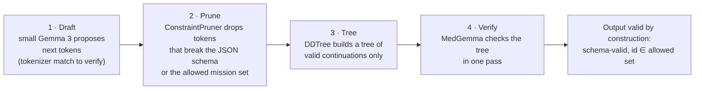

# A09 · Can it run faster and cheaper? (R&D track)

**One-line answer:** Probably, and for the same reason it is safe. The rule that keeps patients safe (output must be a valid JSON id from the allowed set) is also a decoding constraint that removes wasted tokens. We plan constraint-pruned speculative decoding using the team's own Rust library, katgpt-rs. **We have no MedGemma speed number yet.** katgpt-rs is modelless: its published results come from micro-models, not MedGemma. The benchmark below comes before any claim.

## The idea: safety rule = decoding constraint

MedGemma's job in our harness is to return something like `{"mission_id": "walk-10-easy", "reason_codes": ["keep-level"]}`. Almost every token in that output is forced by the schema. Only a few tokens carry a choice, and those choices must come from a small allowed set. So:

katgpt-rs describes this pipeline as "LLM drafts logits → ConstraintPruner filters invalid → DDTree builds valid-only tree → Target verifies". It also has a **spec pruner** that compiles a specification into a token constraint. For us, the specification is the JSON schema plus today's allowed set from the rules engine.

**Why it fits this product:** outputs are short and structured, and the constraint already exists for safety. Speed and safety come from one mechanism instead of two.

## What katgpt-rs is, and is not

| It is | It is not (yet) |
|---|---|
| The team's own Rust library of decoding primitives (MIT licence): ConstraintPruner trait, DDTree, speculative decoding, SubstrateGate (per-capability MLP masks), spec pruner | A runtime that loads MedGemma or Qwen3 weights. The library is modelless |
| Benchmarked on micro-models and constraint puzzles (its README reports results such as Sudoku search compression) | Evidence of any speed-up on a 27B medical model |

So **no katgpt-rs number transfers to MedGemma**. We do not quote its README speed-ups in the pitch.

## Benchmark plan (not run)

Three arms on the same GPU and the same MedGemma request set:

| Arm | Setup |
|---|---|
| 1 | vLLM with guided JSON (grammar-constrained decoding) |
| 2 | Arm 1 + standard speculative decoding (small Gemma 3 draft) |
| 3 | Arm 2 + constraint-pruned trees (allowed set + schema, katgpt-rs-style) |

Metrics: tokens per second (reported as secondary, because forced tokens inflate it), **p95 latency**, **valid-output rate** (must be 100% for arm 3 by construction; measured for all arms), **mission-choice agreement with arm 1**, and **US$ per 1,000 patient-days** (feeds [A08](A08-cost-structure.md)).

Harness check before any number: with pruning switched off, arm 3 must reproduce arm 2's greedy outputs exactly.

## The same idea, already measured on the router

The router is the cheap end of the same thinking ("decide, don't write"). On synthetic data ([A06](A06-tool-router-experiments.md)):

- One-pass scoring vs writing the tool call, Qwen3-1.7B on a T4: **71 ms vs 1,272 ms median**, 78% vs 42% accuracy (n = 36).
- Router v2: about 60% of messages decided by rules with no model. p95 60 ms (1.7B) and 83 ms (4B).

The full neuro-symbolic cascade plan, with what has been measured:

| Tier | What | Measured? |
|---|---|---|
| T0 Rules | Red-flag screen first, then keyword rules for unambiguous intents | Yes (v1, v2) |
| T1 Embedding router | Multilingual encoder + nearest centroid with a margin gate | No |
| T2 One-pass classifier | Score the closed tool list from one forward pass | Yes (v1 config C, v2) |
| T3 Argument filler | Grammar from the tool schema. Jump-forward on forced tokens. Allowed-set masks on enums. Prompt-lookup drafts for copied text | No |
| T4 Capability mask | Structured MLP pruning from activation statistics (the SubstrateGate idea) | No |

**Pre-registered hypothesis:** the cascade is ≥ 3× faster per tool call (median wall-clock, same hardware) and non-inferior on tool accuracy (≤ 1 point worse), with 100% schema-valid output. **Falsified if** accuracy drops by more than 1 point at every setting that reaches 3×, or the speed-up is under 3× at equal accuracy.

## Caveats written down before running

- Qwen3 uses SwiGLU, not ReLU, so activation sparsity is weaker. Neuron pruning may cost accuracy.
- Unstructured sparsity gives no speed on GPU or MPS without special kernels. Only structured pruning (removing whole rows and columns) gives a measurable speed-up in PyTorch.
- A Mac MPS speed-up is not a production GPU speed-up.
- Results on small Qwen3 models do not carry over to MedGemma automatically.
- Most parts have prior art: SGLang jump-forward, XGrammar, prompt-lookup decoding, semantic routers, Wanda/TEAL-style pruning, and hidden-state tool routing ("The Router Within", arXiv 2609.15982; OATS, arXiv 2603.13426). **The possible novelty is the combination** (safety rules, allowed-set constraints and capability masking in one deterministic clinical cascade). A proper novelty check is still to do.

## Sources / evidence in repo

- `docs/pitch/faq-appendix/slides/speed.html`: 4-step pipeline, three-arm benchmark, "no MedGemma number yet"
- `docs/pitch/faq-appendix/README.md`: "makes no MedGemma speed claim; a benchmark is needed first"
- `docs/research/neurosymbolic-tool-router-plan.md`: cascade T0–T4, hypothesis, falsification, caveats, ladder
- `experiments/RESULTS_tool_router_demo.md` and `experiments/*.json`: measured router numbers
- katgpt-rs README (team's own repository, outside this repo; cited in `docs/pitch/faq-appendix/slides/sources.html`)
