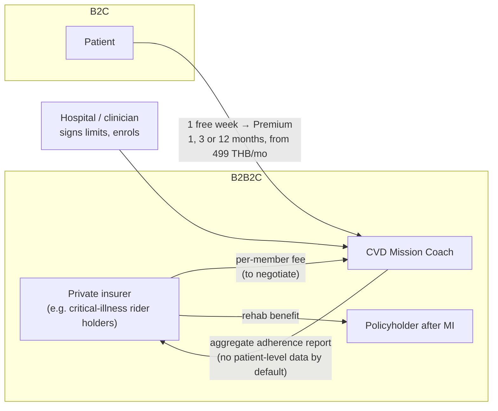

# A11 · Who pays, and who else does this?

**One-line answer:** Two routes. B2B2C: an insurer offers the program as a rehab benefit. B2C: freemium with Premium from 499 THB a month. Thailand's public schemes have no fee code for digital therapeutics, so private payers and self-pay come first. Clinician-led virtual rehab exists abroad (Movn in the US, Cardihab in Australia). We have not found a Thai-language, patient-first, daily-mission competitor, but that is **not** a proven absence. Insurer willingness to pay and Thai prices are still **unvalidated**.

## Business model

| Route | Who pays | Pitch to the payer (allowed wording) | Status |
|---|---|---|---|
| **B2B2C insurer** | Private life or health insurer, as a rehab package (e.g. alongside critical-illness cover) | "Designed to improve rehab adherence, which is linked to fewer readmissions." Cite cardiac-rehab evidence, not our app | **Unverified in Thailand.** Needs insurer conversations |
| **B2C freemium** | Patient or family | One free week, then Premium for 1, 3 or 12 months, from 499 (THB assumed) | **Price is a hypothesis.** No Thai willingness-to-pay data |
| Hospital channel (enabler, not payer yet) | — | Enrolment and limit signing at discharge | Needed for safety anyway: every user needs a clinician-signed limit |

**We do not say "proven to reduce readmissions".** We have no outcome data.

## Price context (model suggestion, not survey data)

The market report suggests Thai self-pay tiers of **299–599 THB/month** (basic) and **1,500–3,500 THB/month** (clinical, with wearable kit and nurse oversight). 499 sits in the basic band. But the panel noted that the 299–599 band was defined for *computer-vision exercise coaching*, and the 1,500–3,500 band cites non-Thai pricing sources. Treat both as orientation only. The same report notes 64.8% of one surveyed population earning ≤ 10,000 THB a month, which argues for the payer route over pure self-pay.

Unit economics we can state: AI inference is about US$0.78 per patient-month on an API, against about US$14 for the price ([A08](A08-cost-structure.md)). Clinician time, the IRIS licence and acquisition cost are **not priced yet**.

## Competitors and analogues

| Name | Where | What | Our difference | Evidence quality |
|---|---|---|---|---|
| **Movn Health** | US | 12-week virtual cardiac rehab (post-AMI, CABG, HF) with smartwatch + BP kit, coaching, remote monitoring | Patient-first daily missions in Thai, clinician limits enforced by rules, FHIR-native | Its "20–30% fewer readmissions" and "$1,377 per patient" are **vendor-reported, US**, not independent trials |
| **Cardihab (SmartCR)** | Australia | App + clinician portal for hybrid or remote phase-2 rehab | Thai language and setting, daily adaptive missions | Reported uptake from 21% to 63% (*JMIR Cardio*, per report). Company-associated |
| **EAPC EXPERT tool** | Europe | Decision support for **clinicians** writing exercise prescriptions | Ours is patient-facing, adapts daily from the watch, conversational | Prior art to acknowledge |
| ChatGPT Health / Claude for Healthcare | US | General assistants connected to health records | Bounded by a signed limit record, rules-first safety, Thai, care team in the loop ([A01](A01-why-not-chatgpt.md)) | News sources, US launches |
| AIA Vitality (insurer wellness) | Thailand | Wearable-linked wellness rewards | A possible **channel**, not a competitor | Cited to an awards page, not AIA. **Unsourced** |
| Kaia, Sword, Hinge, Vivira, Welldoc | Various | MSK or diabetes digital therapeutics | Not cardiac | From model background knowledge, **not cited** |

**Our one-line differentiation:** clinician-set limits with a deterministic safety layer, patient-first daily missions, Thai language, built on FHIR in IRIS for Health.

## Why now in Thailand (to verify against primary sources)

- Thai post-ACS recommendations: rehab no later than 10 days after discharge. Phase-2 uptake after CABG reported at 12.5%, and 83.3% of those patients were never told about it (single site).
- A Thai LINE-based home-rehab study (n = 54) showed better walk-test and quality-of-life scores. LINE is a channel worth adding (caregiver summary).
- Social support predicted readmission in Thai cohorts (β = −0.225). This is correlational, but it supports a caregiver or community feature.

## Weak spots, flagged

| Weak spot | What we do about it |
|---|---|
| No insurer has been spoken to | 3–5 insurer interviews (product or claims lead, actuary) |
| No Thai willingness-to-pay data | 3–5 patient interviews, then a price test inside a clinician-onboarded cohort |
| Day-7 paywall may be too early for habit formation | Test a longer free period, but **only for non-exertional or clinician-limited content** (exercise still needs a signed limit) |
| "88% readmitted" in the market report | Struck. It almost certainly describes readmitted patients only. The same report gives 11–14% as the global 30-day post-AMI readmission range (to verify) |
| Muang Thai Life ">70% CI premium growth" | Cited to an unrelated post. **Unsourced**, not used |
| Smartwatch market sizes | From blogs and paid-report landing pages. Not used on slides |
| No TAM/SAM/SOM | Not presented. A market-sizing number needs Thai post-MI incidence and private-cover data we have not verified |
| Peer community | Panel: not v1-safe as written. Caregiver summaries first. Any shared goals are frequency-only and moderated |

## Cheapest validation step

A **concierge pilot**: human-sent missions over LINE to 8–10 clinician-enrolled patients, after ethics review. It tests adherence and willingness to pay before we build the full stack (suggested by the simulated panel).

## Sources / evidence in repo

- `docs/superpowers/specs/2026-10-17-cvd-mission-coach-design.md` §2b: business model, script review notes, EXPERT tool
- `research/README.md`: market summary and known weak spots
- `research/market/notebooklm-deep-report.md` (machine-generated; team corrections block at top): competitors, insurers, price tiers, Thai rehab data
- `research/pitch-claims-check.md`: which claims are supported
- `evaluation/reviews/2026-10-17-document/SYNTHESIS.md` R12, R13, R16, R17 and "five cheapest actions" (simulated panel)
- `docs/pitch/faq-appendix/slides/chatbot.html`: general-assistant comparison
