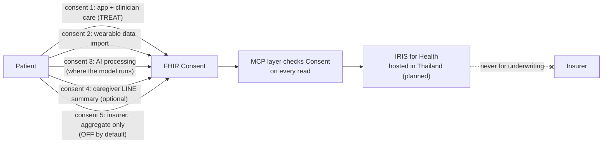

# A12 · Is this a medical device? What about PDPA?

**One-line answer:** We position v1 as lifestyle and rehab-adherence support. Clinician-approved limits go in, and the AI schedules small missions inside them. It does not diagnose, detect or prescribe. Whether Thai FDA would still treat it as Software as a Medical Device is an **open question**, and we will put it to a regulatory lawyer or Thai FDA in writing before any real patient. Under PDPA we hold health data on the basis of explicit, separate consents, encoded as FHIR `Consent`, with insurer access **off** by default.

> Nothing in this file is legal advice. No Thai FDA rule, PDPA provision, OIC rule or IRB requirement has been checked by a lawyer yet. Items marked **needs a real lawyer** are open.

## Positioning and wording

| We say | We avoid | Why |
|---|---|---|
| "A plan kept inside your clinician's safe limits, adjusted each week" | "Optimal, exact plan", "AI exercise prescription" | "Prescription" by an AI likely moves the product into SaMD territory |
| "Designed to improve rehab adherence, which is linked to fewer readmissions" | "Proven to reduce readmissions" | We have no outcome data |
| "Stop now and call 1669" (fixed text, number to confirm) | Any symptom interpretation | Red flags are rules-only |
| "Supports and extends rehab; referral required" | "Replaces cardiac rehab" | Replacing rehab is a stated non-goal |
| "Ask your doctor or pharmacist" | Any drug or dose advice | Rule 9 |

**Intended use (draft, for the lawyer):** helps adults who have had a heart attack and have been enrolled by a clinician to follow the clinician's exercise limits. It does this by scheduling small daily activities and reminders inside a clinician-signed limit record, and by stopping and directing the patient to emergency care on reported warning symptoms. It does not diagnose, set limits, change medication or replace cardiac rehabilitation.

## The Thai FDA SaMD question (open)

| Feature | Risk of being read as a medical function | Our design choice |
|---|---|---|
| Choosing exercise intensity | High if the AI sets it | AI never sets intensity. It picks from a clinician-defined allowed set |
| Red-flag stop message | Could be read as triage | Fixed text, rules only, always "stop and call". No grading of symptoms |
| Discharge-note extraction (MedGemma 1.5 4B) | Could be read as clinical data processing | Extraction is a draft. **A clinician confirms** every field |
| Weekly progression proposal | Could be read as treatment change | Goes to the clinician queue as a proposal. Never applied automatically |
| Eligibility gate | Could be read as risk stratification | Class is entered by a clinician. The app only blocks on unknown or high |

**Needs a real lawyer:** classification under Thai FDA rules for software; whether "exercise prescription" wording changes it; which channel to ask (written intended-use statement + feature list).

## PDPA: consent and data flow

What already exists in the synthetic data: each patient's `Consent` has scope `patient-privacy`, category LOINC 59284-0, policy OPTIN, a permit for purpose TREAT, and a nested **deny** for any actor with role `PAYOR` ("Any insurer"). The `PAYOR` code is **to verify**.

Data-minimising choices already in the design:

- **Home district, not exact address.** `Patient.address.district` plus a district-level position extension, used for the walking area.
- No raw chat or watch streams in the vector index. Only approved content is embedded.
- Insurer sees **aggregate** adherence only, by default never patient-level, and **never for underwriting**.
- Self-hosted models so patient data and model calls stay in Thailand. API models only for de-identified work, if at all.

**Needs a real lawyer (privacy lawyer or hospital DPO):** lawful basis for health data (treated as sensitive data under PDPA, **to verify**); who is controller and who is processor (hospital, us, cloud, model host); cross-border transfer if any model or embedding call leaves Thailand; retention and deletion; the consent text in Thai.

**Needs an insurance lawyer or OIC-literate adviser:** whether an insurer may see individual adherence data at all, and the consent needed for aggregate reports.

## Accountability: who answers for what

| Question | Answer in the design | Recorded in FHIR as |
|---|---|---|
| Who set this limit? | A named clinician, with source test, date and review-by | `CarePlan.author`, `Provenance` (attester), extensions |
| Who chose this mission? | The model, from the allowed set, validated by rules | `Task` + `Provenance` (assembler = AI-model `Device`) |
| What did the agent see and call? | Every turn and tool call is logged | `AuditEvent` (planned) |
| Who was told about a red flag? | The clinician | `Flag` + `Communication` |
| Who owns the limit library? | **A named Siriraj clinician: not yet named** | Governance (rule 11) |

**Needs naming before any patient:** the accountable clinician, the incident-reporting route, and liability allocation (hospital clinical safety committee).

## Ethics

Any real-patient use, including the concierge pilot, goes through a hospital IRB first. A statistician sets the pilot size and states what safety bound it can support. At pilot size, "zero serious events" cannot show safety on its own ([A13](A13-roadmap-mvp.md)).

## Sources / evidence in repo

- `docs/superpowers/specs/2026-10-17-cvd-mission-coach-design.md` §2b script review notes, §4 non-goals, §5 rules 5, 9, 11
- `evaluation/reviews/2026-10-17-document/SYNTHESIS.md` R3, R8, R10 and "needs a real expert" (simulated panel)
- `synthetic/generate_fhir.py`: `Consent` with PAYOR deny, district-only address
- `docs/pitch/faq-appendix/slides/geo.html`: home district under PDPA
- `docs/pitch/faq-appendix/slides/cost.html`: self-hosting for data residency
- `docs/pitch/appendix-slides-plan.md` §A5: Consent enforced on every read by the MCP layer
