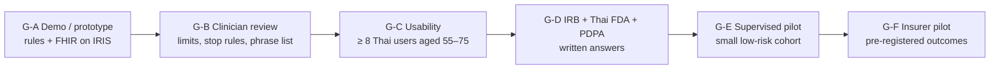

# A13 · Is there a realistic path to an MVP?

**One-line answer:** Yes, through six gates, each with a named human who passes it: demo → clinician review → usability → IRB and Thai FDA → supervised pilot → insurer pilot. The engineering for the demo sits on the InterSystems kit, which we already build on. The critical path is people (a named clinician, a lawyer, an IRB), not code.

## The gates

| Gate | Entry needs | Exit needs | Who passes it | Where we are |
|---|---|---|---|---|
| **G-A Demo / prototype** | Design approved by the team | L1 property tests and L2 red-flag tests pass. Scenarios SC-01…SC-18 pass (SC-16…18 checked by a person). No open S0 in the last panel run (the panel informs; it cannot pass a gate) | Team | **In progress.** UI with rules-only checks (6/6 tests). Synthetic FHIR bundles. Router v1/v2. Scripted agent demo. Not yet: IRIS loaded, SQL Builder, Vector Search, MCP, scenario suite |
| **G-B Clinician review** | G-A done. Limit library written | A real cardiologist and rehab physician review limits, stop rules and the Thai red-flag list **in writing** | Named Siriraj clinicians | `RECONCILE-for-clinician.md` (12 questions) ready to send. Owner not named |
| **G-C Usability** | G-B done | ≥ 8 target-age Thai users finish onboarding and a week of missions in a moderated test, with no S0/S1 issue | Usability lead + cardiac nurse | Not started |
| **G-D Ethics and regulatory** | G-C done | IRB decision. Thai FDA classification confirmed in writing. PDPA consent flow reviewed by a lawyer | IRB, regulatory lawyer, privacy lawyer or DPO | Intended-use draft in [A12](A12-regulatory-pdpa.md) |
| **G-E Supervised pilot** | G-D done | Small low-risk cohort with a named clinician, weekly safety review, pre-written stop rules (any intensity violation or serious event pauses enrolment) | Clinician + statistician | Not started |
| **G-F Insurer pilot** | G-E clean | Pre-registered outcomes (completion, 90-day readmissions against a matched comparison), statistician sign-off | Insurer + statistician | No insurer contacted yet |

## What "MVP" means here

| In the MVP (G-A to G-E) | Out of the MVP |
|---|---|
| Clinician-enrolled, clinician-confirmed **low-risk post-MI** patients only | Heart failure, high-risk hypertension, moderate/high risk without supervision |
| Walking-type missions with warm-up and cool-down. Medication reminders in fixed text | Resistance training, any %HRR calculation |
| Symptom tap + rules-only stop path, clinician flag queue | Peer community with free text |
| Thai text first. Thai voice once a Thai TTS passes testing | Insurer access to patient-level data |
| FHIR on IRIS for Health, SQL Builder rules, Vector Search grounding | Hospital HL7v2/CDA integration (after the pilot) |

## Engineering track (in order, cheapest first)

| # | Step | Uses | Done when |
|---|---|---|---|
| 1 | Load the 9 synthetic bundles into the kit's IRIS for Health | `synthetic/load_to_iris.py` | All bundles return 200. Custom extensions accepted (to verify) |
| 2 | FHIR SQL Builder projection for limits, vitals, tasks, symptom checks, places | Kit tutorial 3.5 | Rules engine reads limits from SQL |
| 3 | Rules engine + property tests + scenario suite | `system-eval.md` | L1, L2 and SC-01…18 green |
| 4 | Vector tables for approved content and activities. Thai embedding test | Kit vector skill, BGE-M3 candidate | Recall@3 measured on a held-out Thai set |
| 5 | MCP server over FHIR with the typed tool list | Kit FastMCP pattern | Tool-scope audit passes (no extra write tools) |
| 6 | Router v3 + red-flag v3 on a **new** human-written blind set | `docs/research/neurosymbolic-tool-router-plan.md` | Red-flag recall reported with its denominator. 0 red flags reach a model |
| 7 | MedGemma 27B single-turn choice with validator. Safe default on any failure | vLLM guided JSON | 100% of outputs in the allowed set (by validation) |
| 8 | Thai TTS choice (Typhoon2-Audio vs JaiTTS). Pre-recorded safety audio | — | Listening test with target-age users |
| 9 | Decoding benchmark (three arms) | [A09](A09-speed-rnd-katgpt.md) | p95 latency and US$ per 1,000 patient-days measured |

## What could stop us, and what we do about it

| Risk | Mitigation |
|---|---|
| No named clinical owner | Ask the Siriraj mentor now, with the reconcile table. Without an owner: no patient use |
| Thai FDA classes it as SaMD | Keep features fixed and clinician-approved. Budget for the matching pathway (to be scoped with a lawyer) |
| Red-flag recall not good enough on real Thai phrasing | Fail toward the stop path. A clinician-written lexicon. An escalate-only model screen |
| Insurers do not pay | B2C and hospital routes. The concierge pilot tests willingness to pay early |
| A pilot cannot show safety statistically | Statistician sets the size and states the bound. Safety rests on the deterministic layers, not on "zero events" |

## Sources / evidence in repo

- `.claude/skills/siriraj-mit-review-panel/references/system-eval.md`: stage gates G-A to G-F, layers, scenarios
- `docs/pitch/appendix-slides-plan.md` §A7: roadmap with gates
- `docs/ui-vs-agentic-plan.md`: current UI status
- `evaluation/reviews/2026-10-17-document/SYNTHESIS.md`: eligibility scope, concierge pilot, statistician note (simulated panel)
- `research/guidelines/RECONCILE-for-clinician.md`
- `synthetic/load_to_iris.py`, `FHIR-AI-Hackathon-Kit/Tutorials/3-fhir/markdown/3.5-projecting-fhir-data-in-sql.md`
- `docs/research/neurosymbolic-tool-router-plan.md`, `experiments/RESULTS_tool_router_demo.md`
